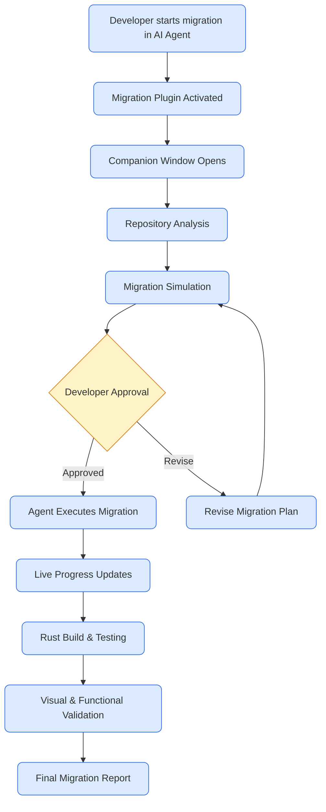

# Product Requirements Document: Rust Made Easy

**Product:** Rust Made Easy — the Migration Brain for anything → Rust. Phase 1 is
Electron → Rust (`electron-to-rust`, binary `e2r`).
**Repository:** https://github.com/mr-vishwet/rust-made-easy
**Author:** Vishwet Nadimetla (mr-vishwet)
**License:** MIT
**Status:** v0.1 (Phase 1) in development. This PRD describes the full vision; the v0.1 CLI is
the first step, not the whole product.

> **A note on names.** An early planning chat sketched this product under the name
> `rust-migrate` with a repo layout of `core/`, `analyzer/`, `compatibility/`, and
> `migration-engine/`. Those names are prior art from that chat. The umbrella ships as
> **Rust Made Easy**; the Phase 1 converter ships as **electron-to-rust** with the **`e2r`**
> binary (the exact-match name matters for search), and this document uses those names
> throughout. A short umbrella-CLI alias, `rme`, is reserved for the future umbrella command.

> **A note on numbers.** The planning chat contains illustrative sample numbers — a readiness
> score of 86/100, "82% of APIs migratable, 18% custom, 94% UI preserved", startup 2.1s →
> 1.7s, memory 380 MB → 265 MB, CPU 22% → 9%, binary 120 MB → 28 MB. **These are ChatGPT's
> illustrative samples, not measurements.** They appear in this PRD only inside the clearly
> marked box in §9, as examples of the *shape* of output the simulator will produce. They must
> never be quoted as results, in this repo or anywhere else. Real numbers come only from
> running the tool on real apps.

---

## 1. Product vision

Every Electron app will eventually face the same question Discord answered on November 4,
2026: when do we leave the browser shell, and how? The answer today is "by hand, over months,
by people who are experts in both Electron internals and Rust" — which is why most teams never
start.

**electron-to-rust exists so that no developer needs to be an expert in Electron internals or
Rust to migrate their app.** It is an AI-powered migration-intelligence layer: the developer
(or their AI coding agent) does the coding; our plugin provides the migration intelligence —
the rules, the checks, the mappings, and the tools.

The goal is **full conversion into Rust** — UI, business logic, and system integration — not
just re-packaging. The first target is Tauri 2 (Rust backend + system webview, UI preserved);
later phases add native-UI targets and, through the Intermediate Representation, other sources
entirely. This product is Phase 1 of the larger Anything-to-Rust vision: every app,
eventually, in Rust — starting with the desktop shell.

The research behind the timing, the prior art, and the gap is in
[docs/RND.md](docs/RND.md). The engineering design is in
[docs/IMPLEMENTATION.md](docs/IMPLEMENTATION.md) and [docs/ARCHITECTURE.md](docs/ARCHITECTURE.md).

## 2. The Migration Brain (product philosophy)

> **The tool is not the agent, not the editor, not the compiler. It is the brain. The agent is
> the hands.**

AI coding agents are powerful hands: they write code fast, in any language, at any scale. What
they lack is judgment about *this specific migration* — which Electron API maps to what, what
breaks, what to check, what was already decided. Left to guess, they guess wrong in ways that
look plausible and fail at runtime.

The Migration Brain is the layer that removes the guessing. It has six parts:

1. **It understands before it writes.** The repository is analyzed first — frontend framework,
   structure, Electron APIs, Node dependencies, bottlenecks — and the migration plan follows
   from that understanding, not from a template.
2. **It is deterministic.** Agents never guess. Every Electron API has an exact, recorded
   replacement: `ipcMain.handle('read-file')` becomes
   `#[tauri::command] fn read_file()`, `ipcRenderer.invoke('read-file')` becomes
   `invoke('read_file')`. The compatibility database is the law; the agent applies it.
3. **It simulates before it migrates.** The pre-migration simulator predicts the migratable
   percentage, how much UI is preserved, and the expected performance gains — with confidence
   ranges — before a single line of code changes. A team can see the shape and the payoff of
   the migration before committing to it. This is the killer feature.
4. **It remembers its decisions.** A decision registry records every migration decision with
   its reason, so agents don't repeat mistakes across sessions or across apps.
5. **It validates.** Runtime simulation, API coverage checks, UI regression detection,
   end-to-end tests, and benchmarks compare the migrated app against the original — and prove
   the zero-UI-regression promise instead of asserting it.
6. **It is agent-agnostic.** The Brain plugs into OpenCode, Claude Code, Codex, Antigravity,
   and VS Code IDEs via MCP servers, agent skills, IDE extensions, and the CLI. Same
   intelligence, whichever hands are doing the coding.

## 3. Three pillars

1. **Full migration.** Architecture, not just packaging. The end state is a real Rust
   application — Rust backend, Rust system integration, Rust where the logic lives — reached
   in stages, not a thinner wrapper around the same JavaScript.
2. **Performance intelligence.** Predict where Rust actually helps, before the work starts:
   memory, CPU, startup time, bundle size, each with a confidence range. Measure the actuals
   after, and learn from the discrepancies so the next prediction is better.
3. **Automated validation.** The migration is not done when the code compiles; it is done when
   the migrated app is proven to behave like the original. Validation is a first-class
   component, not an afterthought.

## 4. Five components

### 4.1 Repository Intelligence Engine

Analyzes the source app before anything is written:

- Detects the frontend framework (React, Vue, Svelte, Angular, vanilla, Quasar, …) and the
  build setup.
- Analyzes the project structure: main process, preload scripts, renderer entry points,
  workers.
- Identifies every Electron API used and every Node dependency — flagging native modules
  (`node-pty`, `better-sqlite3`, …) explicitly.
- Identifies bottlenecks and risk areas (heavy IPC, Chromium-only APIs, DRM, deep OS
  integration).
- Produces a compatibility report: what converts, what needs a human, what can't — with the
  feasibility score.

v0.1 ships this as the regex-based `e2r scan`. The parser-based analyzer and the
Intermediate Representation arrive in Phase 1 of the roadmap (§8).

### 4.2 Automated Rust Migration Engine

Performs the migration the intelligence engine planned:

- Migrates the runtime layer: Electron main process → Rust backend.
- Replaces Electron APIs with their Rust equivalents, per the compatibility database.
- Generates Tauri configs (`tauri.conf.json`, `Cargo.toml`; capability files planned).
- Identifies Node modules needing Rust replacements and names them.
- Generates IPC bridges: Rust `#[tauri::command]` functions plus the TypeScript bridge that
  rebinds `ipcRenderer` to `invoke()`.
- Preserves the frontend where possible — the renderer is carried over: existing build output
  (`dist/`/`build/`/`out/` with an `index.html`) is copied verbatim, bundler source is copied
  with its build script preserved as `build:frontend`, and static renderers are copied into
  `dist/`; a placeholder frontend is generated only when no renderer files are found at all
  (see `MIGRATION-NOTES.md`).

v0.1 ships this as `e2r convert`.

### 4.3 Dependency Replacement Intelligence

The compatibility database — the deterministic heart of the Brain:

- Electron → Tauri/Wry mappings, with status (AUTO / ASSISTED / MANUAL) and notes.
- Node `fs` → `std::fs` / Tokio filesystem APIs.
- Node processes → Rust process APIs.
- Electron IPC → Tauri commands and events.
- Electron packaging → Tauri bundler.
- Native-module recipes (`node-pty` → `portable-pty`, `better-sqlite3` → `rusqlite`, …).

v0.1 ships this as `converters/electron/mappings/electron-to-tauri.json`, mirrored in
[docs/API-MAP.md](docs/API-MAP.md). The database grows by contribution
(see [CONTRIBUTING.md](CONTRIBUTING.md)) and, in Phase 4, by learning from completed
migrations.

### 4.4 Automated Testing & Validation

Proves the migrated app behaves like the original:

- Compares original vs. migrated functionality (record/replay parity checks, in the
  rust-anything style).
- Detects missing APIs — anything the source used that the target doesn't cover.
- Validates IPC: every channel has a handler on both sides, every call has a matching command.
- Build and packaging checks: the generated project must compile (`cargo check`) and bundle.
- Migration reports: what converted, what was validated, what still needs a human.

v0.1 ships the build check. Parity checks and UI regression detection arrive in Phase 2 and 4.

### 4.5 Developer Dashboard

Makes the migration legible while it's happening:

- Completion percentage, by API and by file.
- Replaced dependencies, with what replaced them.
- Manual-intervention items — the ASSISTED and MANUAL list, with reasons.
- Build and test results for the generated project.
- Remaining effort: what's left, and what kind of work it is.

The dashboard is delivered through the Live Migration Companion window (§7), not as a
separate web app: the migration's own window, next to the agent doing the work.

## 5. Two modes

| Mode | What happens | Status |
| --- | --- | --- |
| **UI-preserving (primary)** | Rust backend + WebView frontend. The renderer is kept verbatim inside Tauri's system webview; only the shell and the IPC layer change. | v0.1 |
| **Full native** | Rust UI via egui, Iced, Dioxus, or Slint. The browser is gone entirely — the Discord route. | Phase 4+ |

The strongest promise, across both modes: **zero UI regression**. The migrated app must look
and behave like the original. The validation component exists to prove that, not to assert it.
For full native mode, the per-framework accessibility story must be assessed before any
framework is recommended (currently unverified — see [docs/RND.md](docs/RND.md)).

## 6. Migration intelligence: agent-agnostic by design

The Brain does not care which agent is holding the pen. It plugs into OpenCode, Claude Code,
Codex, Antigravity, and VS Code IDEs through:

- **MCP servers** — the standard interface (ops below).
- **Agent skills** — packaged guidance the agent loads when it starts a migration.
- **IDE extensions** — in-editor access to the plan, the mappings, and the companion.
- **The CLI** (`e2r`) — the same intelligence, scriptable, for humans and CI alike.

What the Brain supplies to any agent:

- The knowledge base (this repo's docs, the R&D, the prior art).
- The compatibility mappings (the deterministic replacements).
- Code analysis (the scan / the IR).
- Migration strategies and codegen templates.
- Rust architecture recommendations for the generated project.
- Testing and regression validation.
- Performance comparison (predicted vs. actual).

### MCP operations (standard interface)

| Operation | What it does |
| --- | --- |
| `analyse_electron_app` | Run the Repository Intelligence Engine on an app directory; return the IR summary, API inventory, and compatibility report. |
| `get_migration_plan` | Return the staged migration plan for an analyzed app: stages, per-API actions, estimated effort. |
| `get_rust_replacement` | Return the exact Rust replacement for one Electron API or Node module, with status and notes. |
| `simulate_migration` | Run the pre-migration simulator; return migratable %, UI preserved, predicted perf gains with confidence ranges. |
| `validate_migration` | Run the validation pipeline on a migrated project; return coverage, parity results, and gaps. |
| `get_decision_log` | Return the decision registry: every decision recorded for this migration, with reasons. |

## 7. Live Migration Companion window (signature feature)

The plugin launches **its own window alongside the coding agent**, showing live progress:

- Files analyzed, APIs replaced, Rust generated.
- Simulation results and warnings.
- Validation results as they land.

**Three modes:**

1. **Simulation** (before) — the pre-migration picture: migratable %, UI preserved, predicted
   gains, warnings. The "should we do this?" view.
2. **Live migration** (during) — progress as the agent works: what's done, what's in flight,
   what's blocked, what's failing.
3. **Verification** (after) — original vs. migrated comparison: parity results, UI regression
   checks, benchmarks.

**Technical decision:** the companion is separate from the agent. The core publishes structured
events over local IPC/WebSocket; the companion (itself a Tauri + Rust app) subscribes. The
agent never owns the display, and the display never owns the migration. Two forms are
supported: a **floating overlay** (small, always-on-top, glanceable) and a **full workspace app**
(the dashboard, the timeline, the detail views).

**Migration Replay:** a timeline of everything that happened — every analysis, replacement,
generation, validation, and decision — for debugging and auditing. A migration you can rewind
is a migration you can trust.

### Live workflow

## 8. Five-phase roadmap

| Phase | Name | What ships |
| --- | --- | --- |
| **1** | Core Intelligence & Simulation | The v0.1 CLI (`scan` + `convert`, data-driven mappings, golden fixture, CI) plus the parser-based analyzer, the Intermediate Representation, the pre-migration simulator, and the decision registry. |
| **2** | Agent Integration | MCP server with the six standard ops, agent skills for OpenCode / Claude Code / Codex / Antigravity, IDE extensions, record/replay parity checks, and the Stage 1 sidecar-shim mode. |
| **3** | Companion Experience | The Live Migration Companion window (overlay + workspace app, three modes), the structured event bus, Migration Replay, and the Developer Dashboard. |
| **4** | ML & Validation | The Performance Prediction Engine's learning loop (predicted vs. actual, fed back into the simulator), UI regression detection, native-module recipes (`node-pty`, `better-sqlite3`, …), and the full-native UI target option (egui / Iced / Dioxus / Slint, accessibility assessed first). |
| **5** | Marketplace & Hosted Intelligence | Community-contributed mappings and recipes as a marketplace, and an optional hosted platform (hosted intelligence, team dashboards, private compatibility data). The open-source core stays open-source. |
| **5+** | Anything-to-Rust | The IR makes other sources possible: Android apps and other frameworks as migration sources, other languages as targets — the full Anything-to-Rust vision, built on the same Brain. |

Phase 1 is this repository, now. Phases 2–5 are the plan; the architecture
([docs/ARCHITECTURE.md](docs/ARCHITECTURE.md)) already reserves their modules, marked
`[PLANNED]`.

## 9. Success criteria

The product succeeds when:

1. **A typical Electron app scans in seconds and converts to a compiling Tauri project** with
   no human intervention for its AUTO surface — and the report says exactly what remains.
2. **The simulator's predictions are honest and improve.** Predicted vs. actual performance is
   measured on every migration and the gap shrinks over time. (Predictions are ranges with
   confidence levels, never single numbers presented as fact.)
3. **Zero UI regression is proven, not claimed.** The validation pipeline diffs original vs.
   migrated behavior and UI, and a migration ships only when the checks pass.
4. **Any agent can drive a migration.** The same MCP ops work from OpenCode, Claude Code,
   Codex, Antigravity, and VS Code — the Brain is genuinely agent-agnostic.
5. **Contributors can add a mapping in an afternoon.** The data-driven design means the
   compatibility database grows faster than any single maintainer could grow it.

> **Illustrative targets (from the planning chat — NOT measurements).** The planning chat
> sketched example simulator output shaped like: readiness 86/100; 82% of APIs migratable,
> 18% custom, 94% UI preserved; startup 2.1s → 1.7s; memory 380 MB → 265 MB; CPU 22% → 9%;
> binary 120 MB → 28 MB. These numbers are invented examples of output *shape*. They are not
> results, not benchmarks, and not promises. Real simulator output will carry confidence
> ranges and will be measured against actuals.

## 10. Non-goals

- **Rewriting the user's UI for them.** UI-preserving mode keeps the renderer verbatim. Full
  native mode is opt-in and a later phase; the tool never rewrites a UI unprompted.
- **Being the agent.** The Brain supplies intelligence; it does not replace the developer's
  agent, editor, or judgment. The agent is the hands.
- **Supporting every Electron API on day one.** The map grows by contribution and by phase.
  An honest MANUAL with a named replacement beats a fake AUTO.
- **A hosted-only product.** The core is open source and runs entirely locally — it reads
  your code and generates code, never phones home, no telemetry. Hosted intelligence (Phase
  5) is optional and additive.
- **Benchmark marketing.** No performance claims without measurements, no ranges presented as
  single numbers, no illustrative samples presented as results. See the honesty note at the
  top of this document.

## 11. Distribution

- **Open-source core** (this repo, MIT): the CLI, the mappings, the Brain library, the MCP
  server, the companion.
- **Agent integrations:** MCP servers, skills, and IDE extensions, distributed with the core
  or through each agent's own channel.
- **Optional hosted platform later** (Phase 5): hosted intelligence, team features, private
  data. The core never depends on it.
