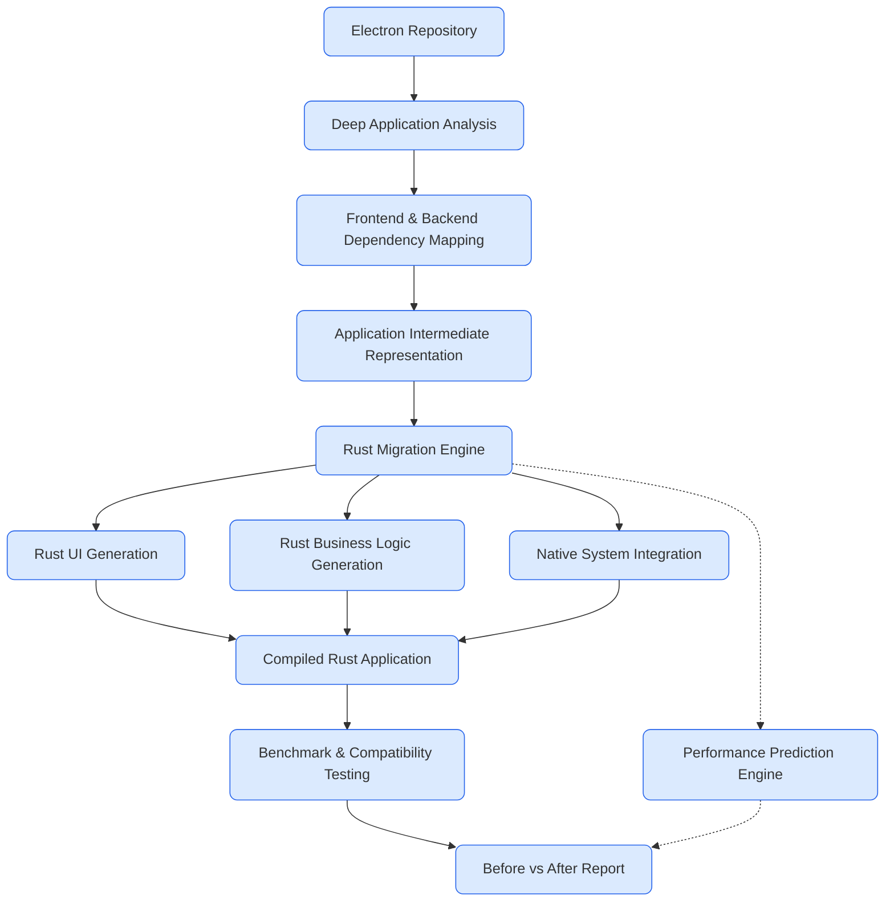
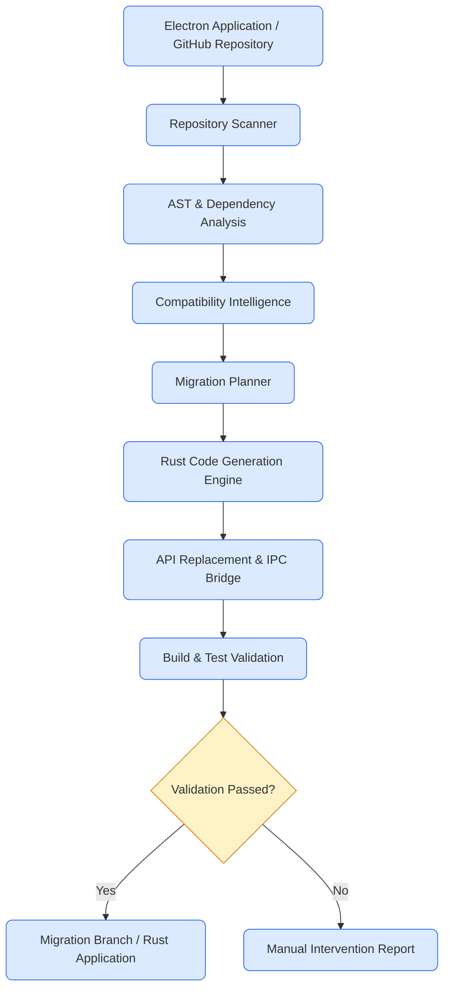
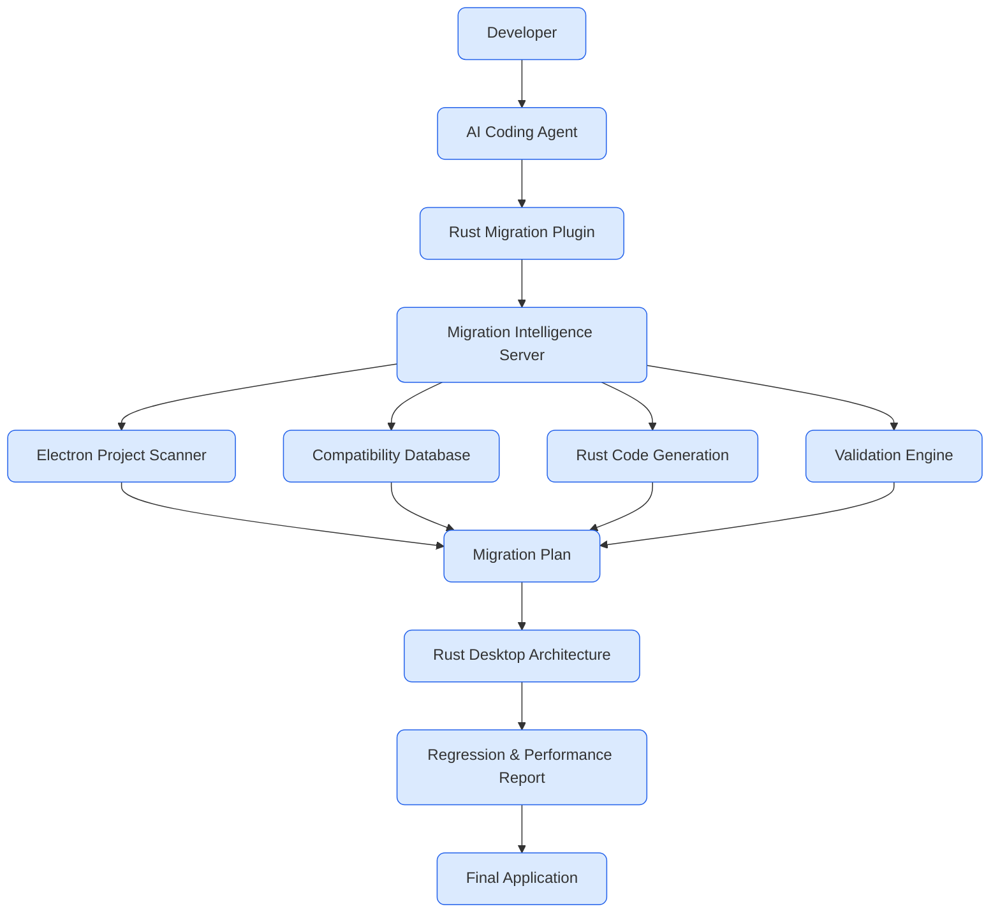
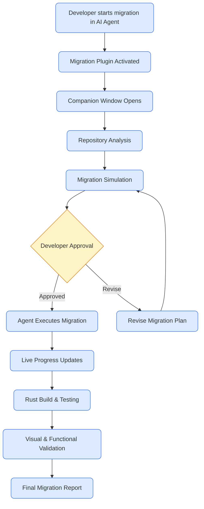

```mermaid
flowchart TD
    Dev["Developer"] --> Codex["Codex"]
    Dev --> Claude["Claude Code"]
    Dev --> OpenCode["OpenCode"]
    Codex --> Brain["Migration Brain"]
    Claude --> Brain
    OpenCode --> Brain
    Brain --> PI["Project Intelligence"]
    Brain --> Sim["Simulation Engine"]
    Brain --> KB["Migration Knowledge Base"]
    Brain --> DR["Decision Registry"]
    Brain --> VE["Validation Engine"]
    PI --> PI1["Electron APIs"]
    PI --> PI2["Architecture"]
    PI --> PI3["Dependencies"]
    Sim --> Sim1["Performance Models"]
    Sim --> Sim2["Compatibility Analysis"]
    Sim --> Sim3["Risk Assessment"]
    KB --> KB1["API Replacement Rules"]
    KB --> KB2["Rust Patterns"]
    KB --> KB3["Decision Registry (history)"]
    DR --> DR1["Preserve UI"]
    DR --> DR2["Retain JavaScript"]
    DR --> DR3["Rust Native UI"]
    DR --> DR4["Performance Targets"]
    VE --> VE1["Test Coverage"]
    VE --> VE2["Visual Comparison"]
    VE --> VE3["API Verification"]
    VE --> VE4["Performance Benchmarking"]
    PI --> Exec["Execute Migration"]
    Sim --> Exec
    KB --> Exec
    DR --> Exec
    VE --> Exec
    Exec --> App["Rust Application"]

    classDef stage fill:#dbeafe,stroke:#2563eb,stroke-width:1px,rx:8,ry:8
    class Dev,Codex,Claude,OpenCode,Brain,PI,Sim,KB,DR,VE,PI1,PI2,PI3,Sim1,Sim2,Sim3,KB1,KB2,KB3,DR1,DR2,DR3,DR4,VE1,VE2,VE3,VE4,Exec,App stage
```

# Rust Made Easy

[](https://github.com/mr-vishwet/rust-made-easy/actions/workflows/ci.yml)
[](https://crates.io/crates/electron-to-rust)
[](LICENSE)
[](https://github.com/mr-vishwet/rust-made-easy)

**Rust conversion, made easy.** **Electron to Rust** is step one: this repo helps you
**convert Electron app to Rust** — it scans your Electron desktop app, reports exactly
which Electron APIs it uses, and generates a working Tauri 2 project from it. If you are
planning an **Electron to Tauri migration**, start here. And Electron is only the first of
a thousand steps: the same Migration Brain will convert Android apps and more — anything,
eventually, in Rust.

> **Status:** early. Phase 1 (Electron → Rust, `e2r`) ships as a working v0.1 CLI:
> `scan` + `convert` for common Electron apps, plus the pre-migration
> simulator (`simulate` + `calibrate`) and the MCP server (`e2r serve`) with
> the agent skill. The rest of the vision — the companion window — is designed
> in [PRD.md](PRD.md) and [docs/IMPLEMENTATION.md](docs/IMPLEMENTATION.md) and
> lands phase by phase.

## How it works



The core idea: **the AI coding agent does the coding; this tool is the brain.** It
understands your app before anything is written, gives the agent deterministic per-API
replacements (never guesses), simulates the migration before any code changes, records
every decision so mistakes aren't repeated, and validates the result. The developer
shouldn't need to be an expert in Electron internals or Rust — the tool carries that
knowledge. Full vision: [PRD.md](PRD.md).

## Converters

| # | Converter | Status | Command |
| --- | --- | --- | --- |
| 1 | [Electron → Rust](converters/electron/) — `electron-to-rust` | **v0.1 shipped** | `e2r scan` / `e2r simulate` / `e2r convert` / `e2r calibrate` / `e2r serve` |
| 2 | Android → Rust | Planned | — |

Each converter is a module under [`converters/`](converters/) with its own crates,
mappings, fixtures, and README. The Intermediate Representation is what makes converter
#2 (and #3, and #1000) possible without rewriting the Brain.

## Quickstart — Phase 1: Electron → Rust

```sh
git clone https://github.com/mr-vishwet/rust-made-easy
cd rust-made-easy
cargo install --path converters/electron/crates/e2r-cli

# 1. X-ray your app: APIs used, IPC channels, feasibility score
e2r scan ./my-electron-app

# 2. Generate a Tauri 2 project
e2r convert ./my-electron-app --out ./my-app-tauri
```

**What `scan` gives you:** every Electron API your app uses, every IPC channel, a
feasibility score, and each API classified AUTO (converts mechanically), ASSISTED
(converts with a human decision), or MANUAL (needs a rewrite or a recipe).

**What `convert` gives you:** a Tauri 2 project — `src-tauri/` with `Cargo.toml`,
`tauri.conf.json`, `lib.rs`, `commands.rs` (one Rust command per `ipcMain` handler),
`main.rs`, a TypeScript bridge (`src/lib/e2r-bridge.ts`) replacing `ipcRenderer`, and a
`MIGRATION-NOTES.md` that says exactly what's left for you. The generated code compiles
— CI runs `cargo check` on it against the golden fixture on every push.

Full converter docs, coverage table, and FAQ:
[converters/electron/README.md](converters/electron/README.md).

## The pre-migration simulator

Before converting anything, `e2r simulate` predicts the migration's shape and
payoff: the migratable breakdown, the UI preservation estimate, predicted gains
with confidence ranges, warnings, and an effort hint. Predictions are ranges with
confidence levels, never single numbers — and the model is research-backed
([docs/RND.md](docs/RND.md) §11): bundle size from measured e2r-generated Tauri
binaries (11.4 MB zero-plugin floor, ~2 MB per plugin), memory per platform
(macOS −40%, Windows ~0%, Linux refused as unmeasured), startup as no improvement
(point exactly 1.0 — the published measurements disagree on which framework is
faster), and CPU refused outright. After the migration, `e2r calibrate` compares
the predictions against measured actuals and feeds the discrepancies back into
the model's confidence intervals.

```sh
# Predict the migration before any code changes
e2r simulate ./my-electron-app --record ./predictions.json

# ... migrate, measure the real app, write measurements.json ...

# Compare predictions vs actuals, and teach the model
e2r calibrate ./my-electron-app --actual ./measurements.json --record ./predictions.json
```

Sample report (trimmed; the minimal fixture app, Linux target):

```
Migration simulation: minimal-electron-app
Feasibility: 100/100 — Good fit — mostly automatic
Model: 0.1.0 (research-backed — predictions are ranges with confidence levels, not measurements)

Migratable breakdown (22 API call sites)
  AUTO      20 (90.9%)
  ASSISTED  2 (9.1%)
  MANUAL    0 (0.0%)

UI preservation (ui-preserving / system webview mode)
  Estimated carry-over: 100.0% unchanged

Predicted gains (before → after)
  bundle size: 90–160 (point 106) MB → 12–22.4 (point 15.4) MB — medium confidence
  memory linux: unknown — no reliable baseline
  startup time: unknown baseline → 0.8–1.3 (point 1) multiple of current startup time — low confidence
  process count linux: 4–6 (point 5) processes → 4–7 (point 5) processes — low confidence
  cpu: unknown — no reliable baseline

Effort hint: small (rough guide)
```

Full simulator docs (model, data sources, calibration loop):
[docs/IMPLEMENTATION.md](docs/IMPLEMENTATION.md) §5 and
[converters/electron/README.md](converters/electron/README.md#commands).

## The MCP server — the Migration Brain for your agent

`e2r serve` exposes the same Brain to any coding agent over the Model Context
Protocol (stdio): the agent does the coding, the server analyses, plans, looks
up, simulates, and validates. Conversion itself stays a CLI step — the agent
runs `e2r convert` in a shell after you have seen the plan and said go.

```sh
# Install (same as the Quickstart above), then point your agent at it
cargo install --path converters/electron/crates/e2r-cli

# Copy-paste configs live in skills/e2r/ — one file per agent:
#   skills/e2r/claude-code.mcp.json  → .mcp.json (project) or ~/.claude.json
#   skills/e2r/codex-config.toml     → ~/.codex/config.toml
#   skills/e2r/opencode.json         → opencode.json (project or ~/.config/opencode/)
# Restart the agent after editing its config, then verify without any agent:
./skills/e2r/smoke-test.sh
```

| Tool | What it does |
| --- | --- |
| `analyse_electron_app` | Scan an Electron app: feasibility score, findings (AUTO/ASSISTED/MANUAL), IPC channels, windows, menus, preload shape. |
| `get_migration_plan` | Ordered migration plan: steps, per-API replacements, MANUAL items first, effort hint. |
| `get_rust_replacement` | Look up one Electron API in the 48-row mappings DB: Tauri equivalent + classification + plugin + notes. |
| `simulate_migration` | Pre-migration simulation: migratable breakdown, UI-preservation estimate, before→after predictions with ranges + confidence + basis. |
| `validate_migration` | Static check of a converted Tauri project: carried over, missing, `TODO(e2r)` stubs remaining, remaining manual work. Does **not** run `cargo check`. |
| `get_decision_log` | The append-only decision registry (`.e2r/decisions.jsonl` in a project, else `~/.cache/e2r/decisions.jsonl`). |

Full tool reference (input schemas, output shapes, error codes, decision-log
format): [docs/MCP.md](docs/MCP.md). The agent skill — when to use the server,
the canonical analyse → simulate → plan → convert → validate workflow, and the
mandatory honesty rules — is [skills/e2r/SKILL.md](skills/e2r/SKILL.md).

## Why now

On November 4, 2026, Discord co-founder and CTO Stanislav Vishnevskiy confirmed on X
that Discord is rebuilding its desktop client in Rust — Electron gone, React Native gone
on mobile — with GPUI (the Zed team's GPU framework) drawing the interface, explicitly
not Tauri. An early Windows build, codenamed "Discord Phoenix", showed ~290 MB of RAM in
a single Task Manager screenshot — one snapshot, not a benchmark, and no release date
yet. But the direction is unmistakable: the biggest Electron app in the world has
decided the browser-shell era is over. Every other Electron team is now asking the same
question Discord already answered.

No shipped automatic converter exists to answer it — as of November 2026 the space is
empty. This repo is the practical answer for teams that don't have Discord's headcount:
a real migration path, in stages, with the UI untouched. The full research — prior art,
the gap, the hard parts, sources — is in [docs/RND.md](docs/RND.md).

## Proof — 5 real apps converted

Discord is framing only: it is not open source and was not converted. The campaign
converted five open-source apps of Discord's class — VS Code, Signal Desktop, Joplin,
Mailspring, Insomnia — with `e2r convert`, then compiled and release-built every
generated project. Full report, matrices, and honest limits: [docs/PROOF.md](docs/PROOF.md).

| App | License | Scan (v3) | Convert + `cargo check` | Measured binary vs Electron installer |
|---|---|---|---|---|
| VS Code | MIT | 19/100 (honest ≈32) | ✅ PASS (408 s check, 1,487 s build) | 26.41 MB vs 280.1 MiB (~11×) |
| Signal Desktop | AGPL-3.0 | 42/100 | ✅ PASS (278 s check, 1,026 s build) | 27.26 MB vs 117.3 MiB (~4.5×) |
| Joplin | AGPL-3.0-or-later | 23/100 | ✅ PASS (448 s check, 1,331 s build) | 23.58 MB vs 160.9 MiB (~7×) |
| Mailspring | GPL-3.0 | 23/100 (honest ~28–29) | ✅ PASS (282 s check, 761 s build) | 22.42 MB vs 138.9 MiB (~6.5×) |
| Insomnia | Apache-2.0 | 46/100 (honest 48) | ✅ PASS (254 s check, 754 s build) | 23.82 MB vs 463.6 MiB (~20×) |

- **5/5 convert, 5/5 `cargo check`, 5/5 release build** — no hand-fixes to generated code.
- **5/5 measured binaries inside their predicted binary intervals** — after the campaign caught and corrected its own calibration mistake (the first round compared binary-alone measurements against bundle intervals, 0/5 inside; the fix compares like with like — see [docs/PROOF.md](docs/PROOF.md#6-the-calibration-story--read-this-before-quoting-any-calibration-number)).
- **Scan accuracy, hand-verified: v3 79/101 = 78.2%** (v2: 85/101 = 84.2%; v1: 102/134 = 76.1%). Honest scores after the re-check: VS Code ≈32 (not 19 — `keytar` is a mock, not a native), Mailspring ~28–29 (not 23 — remote double-counting), Insomnia 48 (not 46 — one false positive) — full report: [docs/ACCURACY-V3.md](docs/ACCURACY-V3.md).
- **Binary-vs-installer is not bundle-vs-bundle.** Every generated project ships a placeholder frontend, so no shipped-bundle figure exists yet — and no runtime metric (memory, startup) was measured. `cargo check` passing means the generated project compiles, not that the app works.

## The Migration Brain

Five components, three pillars, one promise: **zero UI regression.**

- **Repository Intelligence Engine** — detects your framework, maps your structure,
  enumerates Electron APIs and Node deps, finds bottlenecks, writes the compatibility
  report. (v0.1 ships this as `e2r scan`.)
- **Automated Rust Migration Engine** — replaces Electron APIs with Rust equivalents,
  generates Tauri configs, names the Node modules needing Rust replacements, generates
  IPC bridges, preserves the frontend where possible. (v0.1 ships this as `e2r convert`.)
- **Dependency Replacement Intelligence** — the compatibility database: Electron →
  Tauri/Wry, Node `fs` → `std::fs`/Tokio, processes → Rust process APIs, IPC → Tauri
  commands/events, packaging → Tauri bundler. Deterministic: agents never guess.
- **Automated Testing & Validation** — original vs. migrated comparison, missing-API
  detection, IPC validation, build/packaging checks, migration reports.
- **Developer Dashboard** — completion %, replaced deps, manual-intervention items,
  build/test results, remaining effort. (Becomes the Live Migration Companion window.)

The three pillars: **full migration** (architecture, not just packaging), **performance
intelligence** (predict where Rust actually helps, with confidence ranges, *before*
migrating — then measure actuals and learn), and **automated validation**. The engine
reasons over an **Intermediate Representation** of your app — never a naive
source-to-source converter — which is what lets new sources and targets plug in later.

## Roadmap

| Phase | Name | What ships |
| --- | --- | --- |
| **1** | Core Intelligence & Simulation | The v0.1 CLI (`scan` + `convert`, data-driven mappings, golden fixture, CI) plus the parser-based analyzer, the Intermediate Representation, the pre-migration simulator (shipped: `simulate` + `calibrate`), and the decision registry. |
| **2** | Agent Integration | MCP server (shipped: `analyse_electron_app`, `get_migration_plan`, `get_rust_replacement`, `simulate_migration`, `validate_migration`, `get_decision_log`), agent skills (shipped: OpenCode, Claude Code, Codex; Antigravity planned), IDE extensions, record/replay parity checks, and the Stage 1 sidecar-shim mode. |
| **3** | Companion Experience | The Live Migration Companion window (floating overlay + full workspace app; Simulation / Live / Verification modes), the structured event bus, Migration Replay, and the Developer Dashboard. |
| **4** | ML & Validation | The Performance Prediction Engine's learning loop (predicted vs. actual, fed back into the simulator), UI regression detection, native-module recipes (`node-pty`, `better-sqlite3`), and the full-native UI target option (egui / Iced / Dioxus / Slint — and GPUI for teams that want Discord's route). |
| **5** | Marketplace & Hosted Intelligence | Community-contributed mappings and recipes as a marketplace, and an optional hosted platform. The open-source core stays open source. |
| **5+** | Anything-to-Rust | The IR makes other sources possible: Android apps and other frameworks as migration sources — the full Anything-to-Rust vision, built on the same Brain. |

The future umbrella CLI will be `rme` (`rust-made-easy`) — one command across converters,
e.g. `rme convert --from electron`. It is a reserved name for now; Phase 1 ships the
Electron converter as `e2r` only.

## Architecture

All five architecture diagrams from the original planning discussion, recreated as native
Mermaid (our own assets — no third-party images). The hero diagram is at the top of this
README; the other four are below, with full versions and explanatory prose in the docs.

<details>
<summary><b>Recommended architecture</b> — the end-to-end pipeline with its validation gate (full version: <a href="docs/IMPLEMENTATION.md">docs/IMPLEMENTATION.md</a>)</summary>



</details>

<details>
<summary><b>Plugin ecosystem architecture</b> — developer, agent, plugin, and Migration Intelligence Server (full version: <a href="docs/ARCHITECTURE.md">docs/ARCHITECTURE.md</a>)</summary>



</details>

<details>
<summary><b>Migration Brain architecture</b> — the brain between the agent and the migration (full version: <a href="docs/ARCHITECTURE.md">docs/ARCHITECTURE.md</a>)</summary>



</details>

<details>
<summary><b>Live workflow</b> — the companion-window journey from start to final report (full version: <a href="PRD.md">PRD.md §7</a>)</summary>



</details>

## FAQ

**Is this affiliated with Tauri, Discord, or rust-anything?**
No. This is an independent project by [Vishwet Nadimetla](https://github.com/mr-vishwet).
It targets Tauri 2, cites Discord's public announcement as motivation, and is
complementary to [rust-anything](https://github.com/erkamyaman/rust-anything) (which ports
application logic; this tool ports the Electron shell). None of those projects endorse it.

**Does it rewrite my UI?**
No. In UI-preserving mode (the primary mode) your renderer runs unchanged in Tauri's
webview; only the main process and the IPC layer change. A native-UI target is phase 4,
opt-in.

**What about native modules like `node-pty` or `better-sqlite3`?**
Honestly: they are the hard part, and v0.1 does not convert them automatically. `scan`
flags them as MANUAL with the Rust crate that replaces them, and the migration notes say
so up front.

**Can I use this on a proprietary / closed-source app?**
Yes. Everything runs on your machine, reads your code, and generates code. It never
phones home and collects no telemetry.

More converter questions: [converters/electron/README.md](converters/electron/README.md#faq).

## Docs

- [PRD.md](PRD.md) — product vision, Migration Brain philosophy, roadmap, success criteria.
- [docs/RND.md](docs/RND.md) — the research: Discord moment, prior art, the gap, honest hard parts.
- [docs/ARCHITECTURE.md](docs/ARCHITECTURE.md) — crate layout, data flow, planned modules.
- [docs/IMPLEMENTATION.md](docs/IMPLEMENTATION.md) — engineering design: IR, analyzer,
  simulator, decision registry, validation, companion event protocol, ML loop.
- [docs/MCP.md](docs/MCP.md) — the MCP server: the six tools, input schemas,
  output shapes, error codes, and the decision-log format.
- [docs/API-MAP.md](docs/API-MAP.md) — the Electron → Tauri API map (mirrors the mappings JSON).

## Contributing

Bug reports, new API mappings, fixtures from real apps, and documentation fixes are all
welcome. See [CONTRIBUTING.md](CONTRIBUTING.md).

## License

MIT. See [LICENSE](LICENSE).

---

*Electron is step 1 of 1000. Every app, eventually, in Rust — made easy.*
