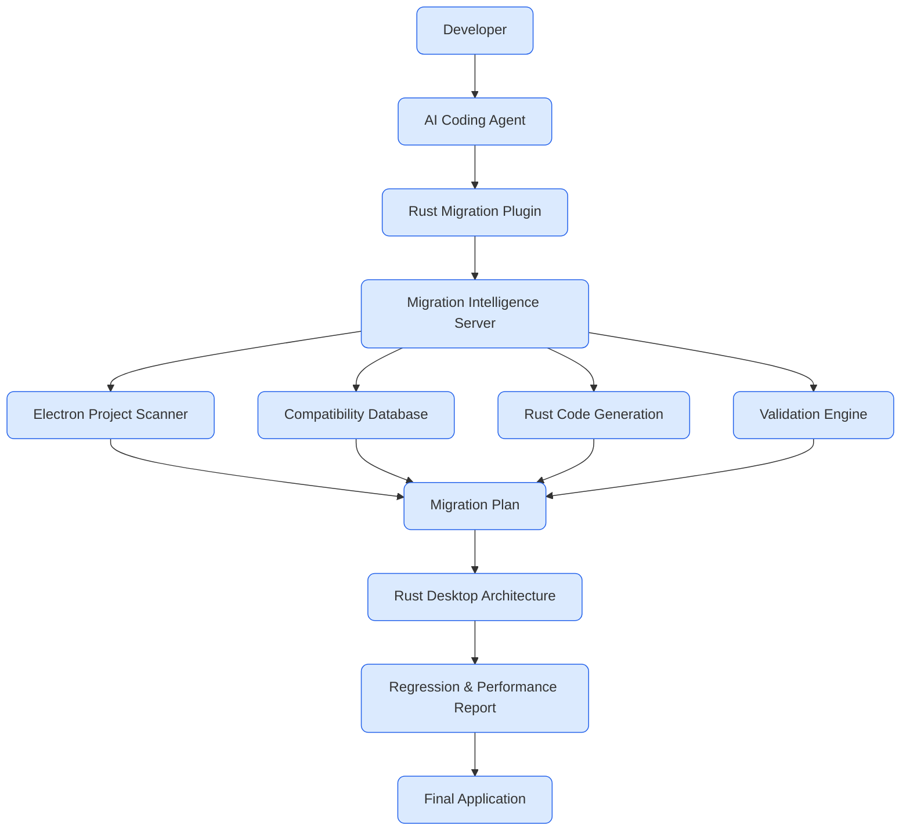

# Architecture

How `electron-to-rust` is built, how data flows through it, and where the planned
Migration Brain pieces fit. The v0.1 CLI is the shipped part; everything marked **[PLANNED]**
is designed but not yet built — see [PRD.md](../PRD.md) and
[IMPLEMENTATION.md](IMPLEMENTATION.md) for the roadmap that delivers it.

## Crate layout

The repository is a Cargo workspace. The umbrella repo hosts one converter module per
source platform under `converters/`; v0.1 ships one binary crate (the Electron converter).
The planned crates are listed so contributors can see where new code belongs.

```
rust-made-easy/
├── Cargo.toml                  # workspace root (members: converters/*/crates/*)
├── Cargo.lock
├── converters/
│   ├── README.md               # converter index: what exists, what's next
│   ├── electron/               # converter #1: Electron → Rust (v0.1, shipped)
│   │   ├── README.md           # converter readme: quickstart, what converts, FAQ
│   │   ├── mappings/
│   │   │   └── electron-to-tauri.json  # the compatibility database (source of truth)
│   │   ├── fixtures/           # small real Electron apps for tests
│   │   │   └── minimal-electron-app/   # the golden fixture: scanned + converted in CI
│   │   └── crates/
│   │       ├── e2r-cli/        # the `e2r` binary (v0.1, shipped)
│   │       │   ├── Cargo.toml  # package `electron-to-rust`, bin `e2r`, lib `e2r_lib`
│   │       │   ├── src/
│   │       │   │   ├── main.rs     # CLI entry: arg parsing, subcommand dispatch
│   │       │   │   ├── lib.rs      # module wiring
│   │       │   │   ├── scan.rs     # the X-ray: walk the app, detect APIs + IPC
│   │       │   │   ├── convert.rs  # pipeline + codegen: scan → map → generate
│   │       │   │   ├── mappings.rs # load + query the embedded mappings table
│   │       │   │   └── model.rs    # shared types: ScanReport, Finding, IpcChannel, ...
│   │       │   └── tests/
│   │       │       └── golden.rs   # scan + convert the fixture; cargo check the output
│   │       ├── e2r-core/       # [PLANNED] the Migration Brain library (phase 1)
│   │       │   └── src/
│   │       │       ├── ir.rs       # the Intermediate Representation
│   │       │       ├── analyzer.rs # parser-based analysis producing the IR
│   │       │       ├── simulator.rs# pre-migration simulation + perf prediction
│   │       │       ├── decisions.rs# the decision registry
│   │       │       └── events.rs   # structured event bus (companion window feed)
│   │       ├── e2r-mcp/        # [PLANNED] MCP server for agent integration (phase 2)
│   │       │   └── src/
│   │       │       └── server.rs   # analyse_electron_app, get_migration_plan, ...
│   │       └── e2r-companion/  # [PLANNED] Live Migration Companion window (phase 3)
│   │           └── src/        # Tauri + Rust app subscribing to the event bus
│   └── android/                # [PLANNED] converter #2: Android → Rust
├── crates/                     # [PLANNED] umbrella shared crates (rme-core, rme-mcp, ...)
└── docs/
    ├── RND.md
    ├── ARCHITECTURE.md         # this file
    ├── API-MAP.md
    ├── IMPLEMENTATION.md
    └── assets/                 # hero diagram (.mmd source + rendered .svg)
```

### Module responsibilities (v0.1)

| Module | Owns | Does not own |
| --- | --- | --- |
| `main.rs` | CLI parsing (clap), subcommand dispatch, exit codes, user-facing error text | Any analysis or generation logic |
| `scan.rs` | Walking the app directory, finding `package.json` / main / preload / renderer files, running the API and IPC detectors, computing the feasibility score | Mapping decisions (it reports *what* was found; `mappings.rs` decides what it means) |
| `convert.rs` | The conversion pipeline (run a scan, resolve mappings, write output) **and** the codegen itself — the `gen_*` functions that render `src-tauri/`, the bridge, and `MIGRATION-NOTES.md` live here for now; splitting them into a `codegen/` module is a future refactor | Mapping decisions (those live in the JSON table) |
| `mappings.rs` | Loading the embedded mappings table (`converters/electron/mappings/electron-to-tauri.json`, compiled in via `include_str!`), looking up an API, returning its target / plugin / status / notes | The JSON content (edited by hand, reviewed as data) |
| `model.rs` | The shared types everything else passes around | I/O of any kind |

### Planned modules

| Module | Phase | Purpose |
| --- | --- | --- |
| `e2r-core::ir` | 1 | The Intermediate Representation: windows, IPC channels, APIs, dependencies, data flows, as typed data the engine reasons about — not source text. See [IMPLEMENTATION.md](IMPLEMENTATION.md). |
| `e2r-core::analyzer` | 1 | Parser-based analysis (replacing the v0.1 regex scanner) producing the IR, plus framework detection and bottleneck analysis. |
| `e2r-core::simulator` | 1 | Pre-migration simulation: migratable %, UI preserved, predicted perf gains with confidence ranges. |
| `e2r-core::decisions` | 1 | The decision registry: every migration decision recorded with its reason, queryable by agents. |
| `e2r-core::events` | 3 | The structured event bus: the core publishes `file.analyzed`, `api.replaced`, `rust.generated`, `validation.failed`, … over local IPC/WebSocket; the companion subscribes. |
| `e2r-mcp::server` | 2 | MCP server exposing the standard ops — `analyse_electron_app`, `get_migration_plan`, `get_rust_replacement`, `simulate_migration`, `validate_migration`, `get_decision_log` — so any agent (OpenCode, Claude Code, Codex, Antigravity, VS Code) can use the Brain. |
| `e2r-companion` | 3 | The Live Migration Companion window (Tauri + Rust): Simulation / Live migration / Verification modes, floating overlay + full workspace app forms, Migration Replay timeline. |

## Data flow

```
                         mappings/
                   electron-to-tauri.json
                            │
                            ▼
   Electron app ──► scan ──► resolve ──► codegen ──► verify ──► Tauri 2 project
   (package.json,      │        mappings      │          │        (src-tauri/,
    main.js,           │        (AUTO /       │          │         bridge,
    preload.js,        │        ASSISTED /    │          │         MIGRATION-
    renderer)          │        MANUAL)       │          │         NOTES.md)
                       │                      │          │
                       ▼                      ▼          ▼
                  scan report          generated     cargo check
                  (APIs, IPC,          files         (+ parity tests
                   feasibility)                       in phase 2)
```

In the planned architecture the scan step is replaced by the analyzer producing an IR, and
codegen renders *from the IR* rather than from scan output — which is what makes other sources
and targets possible later:

```
   [PLANNED]
   Electron app ──► analyzer ──► IR ──► simulator ──► plan
                                     │
                                     ├──► codegen (Tauri 2) ──► verify
                                     └──► codegen (native UI) ──► verify  [phase 4]
                                     └──► events ──► companion window
```

## Planned architecture diagrams

The two diagrams below are the full-vision views from the original planning discussion,
redrawn as native Mermaid. Both are **[PLANNED]** — they describe where the architecture is
headed (phases 2–5), not what v0.1 ships.

### Plugin ecosystem

How the developer, the coding agent, the plugin, and the Migration Intelligence Server fit
together:



### Migration Brain

The brain sits between the agent and the migration: it understands, simulates, decides, and
validates, while the agent does the coding ("the tool is not the agent, not the editor, not
the compiler — it is the brain; the agent is the hands"):

```mermaid
flowchart TD
    Dev["Developer"] --> Codex["Codex"]
    Dev --> Claude["Claude Code"]
    Dev --> OpenCode["OpenCode"]
    Codex --> Brain["Migration Brain"]
    Claude --> Brain
    OpenCode --> Brain
    Brain --> PI["Project Intelligence"]
    Brain --> Sim["Simulation Engine"]
    Brain --> KB["Migration Knowledge Base"]
    Brain --> DR["Decision Registry"]
    Brain --> VE["Validation Engine"]
    PI --> PI1["Electron APIs"]
    PI --> PI2["Architecture"]
    PI --> PI3["Dependencies"]
    Sim --> Sim1["Performance Models"]
    Sim --> Sim2["Compatibility Analysis"]
    Sim --> Sim3["Risk Assessment"]
    KB --> KB1["API Replacement Rules"]
    KB --> KB2["Rust Patterns"]
    KB --> KB3["Decision Registry (history)"]
    DR --> DR1["Preserve UI"]
    DR --> DR2["Retain JavaScript"]
    DR --> DR3["Rust Native UI"]
    DR --> DR4["Performance Targets"]
    VE --> VE1["Test Coverage"]
    VE --> VE2["Visual Comparison"]
    VE --> VE3["API Verification"]
    VE --> VE4["Performance Benchmarking"]
    PI --> Exec["Execute Migration"]
    Sim --> Exec
    KB --> Exec
    DR --> Exec
    VE --> Exec
    Exec --> App["Rust Application"]

    classDef stage fill:#dbeafe,stroke:#2563eb,stroke-width:1px,rx:8,ry:8
    class Dev,Codex,Claude,OpenCode,Brain,PI,Sim,KB,DR,VE,PI1,PI2,PI3,Sim1,Sim2,Sim3,KB1,KB2,KB3,DR1,DR2,DR3,DR4,VE1,VE2,VE3,VE4,Exec,App stage
```



## How mappings.json drives codegen

The mappings file is the single source of truth for what converts and how. Codegen never
hardcodes an Electron→Tauri translation; it asks the mappings layer.

```jsonc
// converters/electron/mappings/electron-to-tauri.json (illustrative entry)
{
  "electron_api": "dialog.showOpenDialog",
  "tauri_target": "tauri-plugin-dialog",
  "plugin": "tauri-plugin-dialog",
  "crate_feature": null,
  "status": "AUTO",
  "command_template": "dialog_open",
  "notes": "Options map 1:1 except `properties` values; see API-MAP.md."
}
```

The flow for each detected API use:

1. `scan` reports `dialog.showOpenDialog` used in `main.js`.
2. `mappings` resolves it to `tauri-plugin-dialog`, status AUTO, template `dialog_open`.
3. `codegen` adds `tauri-plugin-dialog` to the generated `Cargo.toml` and `tauri.conf.json`,
   emits the Rust command from the `dialog_open` template, and wires the bridge call.
4. If the status were ASSISTED, codegen would emit the code *and* a named decision in
   `MIGRATION-NOTES.md`. If MANUAL, it emits a stub, the named Rust replacement, and a note —
   and the app still builds.

Adding a mapping is therefore a data change plus, for AUTO entries, a template and a test.
See [CONTRIBUTING.md](../CONTRIBUTING.md).

## How scan works — and its limits

v0.1 scanning is **regex-based**: it matches patterns like `require('electron')`,
`ipcMain.handle('channel', …)`, `new BrowserWindow(…)`, and `dialog.showOpenDialog(` across
the app's JavaScript and TypeScript files, and reads `package.json` for the dependency list
(including native modules).

That is deliberately simple, and it has known limits:

- **False positives.** A matched string in a comment, a string literal, or dead code counts as
  a use. The scan report shows the file and line for every hit so a human can judge.
- **False negatives.** Dynamic requires, aliased imports (`const { ipcMain: ipc } = …`),
  re-exported Electron APIs, and APIs reached through wrapper libraries are missed. The
  report says the scan is regex-based and names this limit.
- **No data flow.** The scanner knows *that* `ipcRenderer.invoke('read-file')` is called; it
  does not know what the handler does with the argument. Semantic reasoning needs the
  parser-based analyzer and the IR (phase 1).

The rule for v0.1: the scanner's job is to be *useful and honest*, not complete. A scan that
misses an API is a bug to fix with a new pattern and a fixture; a scan that claims certainty
it doesn't have is a design failure. The feasibility score is computed from what was found,
and the report states the method.

## Testing strategy

- **Unit tests** in each module: mapping lookups, score computation, template rendering.
- **Golden fixture test:** the suite scans `converters/electron/converters/electron/fixtures/minimal-electron-app/`, converts it, and runs
  `cargo check` on the generated Tauri project. Generated code that doesn't compile fails
  the build. This is the most important test in the repo.
- **Fixture-per-API tests:** each mapping has a fixture exercising it, so a regression in one
  mapping is caught by its own fixture, not by a vague failure.
- **Scan-pattern tests:** positive and negative cases for every detector pattern, including
  the known false-positive shapes (comments, string literals).
- **Round-trip discipline:** every fix ships with a test that fails without it
  (see [CONTRIBUTING.md](../CONTRIBUTING.md)).

Phase 2 adds **record/replay parity tests**: run the original Electron app and the migrated
Tauri app through the same cases and diff behavior, in the rust-anything style. Phase 4 adds
the learning loop: predicted vs. actual performance, fed back into the simulator.

## Extension points

| To add… | Do this |
| --- | --- |
| A new API mapping | Add a JSON entry + (for AUTO) a template + a fixture. No core code changes. |
| A new codegen target (e.g. native UI) | Add a codegen module rendering from the IR + a mappings file for that target. The analyzer and simulator don't change. |
| A new source framework | Add an analyzer producing the same IR. Downstream (simulator, codegen, validation) is unchanged. |
| A new agent integration | Speak MCP against `e2r-mcp`, or consume the event bus. The Brain is agent-agnostic by design. |
| A new validation check | Add a check to the validation pipeline; it runs against the IR and the generated project, and its result is an event on the bus. |

The invariant behind all of them: **the IR is the seam**. Everything upstream of it knows
about Electron; everything downstream of it doesn't. That is what makes "anything to Rust" a
real architecture instead of a slogan.
