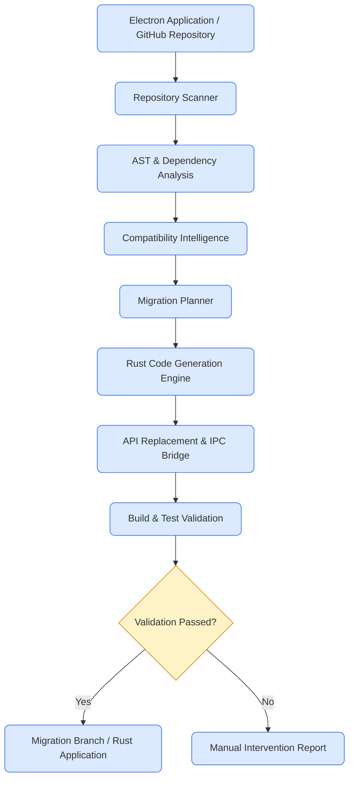
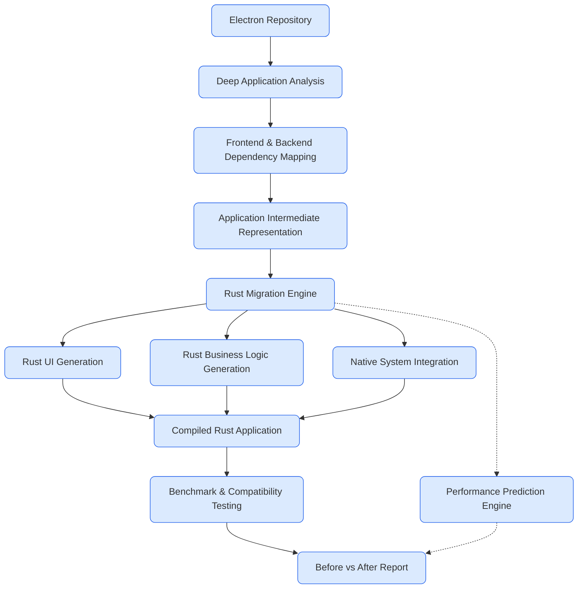

# Implementation: engineering architecture

The engineering design for the Migration Brain — the Intermediate Representation, the analyzer
pipeline, the compatibility database, codegen, the simulator, the decision registry, the
validation pipeline, the companion event protocol, and the ML learning loop. This document
describes the full design; the parts that exist in v0.1 are marked **[SHIPPED]**, the rest
**[PLANNED]** with the phase that delivers them.

Companion docs: [PRD.md](../PRD.md) (product vision and roadmap),
[ARCHITECTURE.md](ARCHITECTURE.md) (crate layout and module responsibilities),
[RND.md](RND.md) (research and prior art).

> **Naming note.** An early planning chat sketched this product as `rust-migrate` with a repo
> layout of `core/`, `analyzer/`, `compatibility/`, `migration-engine/`. That sketch is prior
> art. The umbrella repo is **Rust Made Easy**; the Phase 1 converter ships as
> **electron-to-rust** (`e2r`) under `converters/electron/`, with the workspace layout in
> [ARCHITECTURE.md](ARCHITECTURE.md).

## Pipeline at a glance

Two views of the same pipeline, both recreated from the original planning discussion as
native Mermaid. The first is the recommended architecture — the pipeline with its validation
gate. The second is the proposed product architecture — the end-to-end concept with the IR
and the Performance Prediction Engine; it is also the hero diagram in
[README.md](../README.md).



### Proposed product architecture





Mermaid source: [`assets/architecture.mmd`](assets/architecture.mmd). The SVG above is
rendered from that source (see [`assets/README.md`](assets/README.md) for the regen
command).

---

## 1. Intermediate Representation (IR) — [PLANNED, phase 1]

### 1.1 Why an IR, not source-to-source conversion

A naive source-to-source converter translates text: it sees `ipcMain.handle('read-file', …)`
and emits a Rust function. That works until it doesn't — aliased imports, dynamic requires,
wrapper libraries, and data flow all break text matching, and every new source framework or
target needs a new converter.

The IR is the fix: the engine builds a **typed, semantic model of the app** — its windows,
IPC channels, APIs, dependencies, and data flows — and everything downstream reasons about
the model, not the source text. New sources become new analyzers producing the same IR; new
targets become new codegen modules rendering from the same IR. The IR is the seam that makes
"anything to Rust" a real architecture.

### 1.2 IR schema (draft)

```rust
// e2r-core::ir — illustrative; the exact schema evolves with the analyzer.

pub struct AppIr {
    pub meta: AppMeta,              // name, version, entry points, framework
    pub windows: Vec<Window>,       // BrowserWindow declarations + options
    pub ipc: IpcGraph,              // channels, handlers, call sites, payloads
    pub apis: Vec<ApiUse>,          // Electron API uses, with file + line
    pub deps: Vec<Dependency>,      // Node deps, native modules flagged
    pub preload: Vec<PreloadScript>,// preload scripts + their bridge surface
    pub assets: Vec<Asset>,         // icons, static files, extra resources
    pub build: BuildConfig,         // packager config, signing, targets
}

pub struct AppMeta {
    pub name: String,
    pub version: String,
    pub frontend_framework: Framework, // React | Vue | Svelte | Angular | Quasar | Vanilla | Unknown
    pub main_entry: PathBuf,
    pub package_manager: PackageManager,
}

pub struct IpcGraph {
    pub channels: Vec<IpcChannel>,  // name, direction, handler location, payload shape (if inferable)
}

pub struct IpcChannel {
    pub name: String,
    pub direction: Direction,       // MainToRenderer | RendererToMain | Bidirectional
    pub handler: Option<Location>,  // where ipcMain.handle/on lives
    pub call_sites: Vec<Location>,  // where ipcRenderer.invoke/send/on lives
    pub payload: PayloadShape,      // Unknown | Inferred(String) — best effort in v1
}

pub struct ApiUse {
    pub api: String,                // e.g. "dialog.showOpenDialog"
    pub location: Location,
    pub mapping: MappingRef,        // resolved from the compatibility DB
}
```

Design rules:

- **The IR is serializable** (JSON) so it can be cached, diffed, sent to the companion, and
  inspected by agents. `e2r scan --ir` dumps it.
- **The IR is lossy by design about code, lossless about structure.** It does not contain
  function bodies — only the facts the migration needs. Handler bodies are ported by the
  agent, guided by the IR, not by the IR itself.
- **Every IR node carries provenance** (file + line) so any claim the tool makes can be
  traced back to the source that produced it.

### 1.3 v0.1 vs. IR

v0.1's `scan` produces a flat report (API list, IPC channel list, feasibility score) from
regex matching — effectively a proto-IR without the graph structure. The phase 1 analyzer
replaces the regex layer with a parser and produces the full IR; the scan report becomes a
rendering of the IR. The CLI surface (`e2r scan`) doesn't change; the depth underneath it does.

---

## 2. Analyzer pipeline — [SHIPPED: regex scan; PLANNED: parser-based, phase 1]

```
app directory
  │  1. manifest:   read package.json (+ lockfile) → deps, scripts, electron version
  │  2. entry:      find main entry, preload scripts, renderer roots
  │  3. parse:      [v0.1] regex patterns over JS/TS files
  │                 [phase 1] real parser (swc-style AST) → resolve imports/aliases
  │  4. inventory:  Electron APIs, IPC channels (both ends), native modules
  │  5. framework:  detect renderer framework from deps + file shapes
  │  6. risk:       flag Chromium-only APIs, DRM, deep OS integration, WebKit-sensitive UI
  ▼
IR + compatibility report + feasibility score
```

Analyzer requirements:

- **Read-only.** The analyzer never writes to the source app. All output goes to stdout, a
  report file, or the `--out` directory of a conversion.
- **Deterministic.** Same app, same IR. No timestamps, no randomness, no network.
- **Honest about limits.** The report states the analysis method (regex in v0.1, parser in
  phase 1) and its known blind spots — dynamic requires, aliased imports, wrapper libraries —
  rather than claiming completeness it doesn't have.
- **Fast enough to run on every save.** The scan is the tight loop of the whole product; the
  analyzer budget is seconds, not minutes, for a typical app.

---

## 3. Compatibility DB schema — [SHIPPED: JSON; PLANNED: versioned + extensible, phase 1]

The compatibility database is `converters/electron/mappings/electron-to-tauri.json` in v0.1 — a flat list of
entries, each one a deterministic replacement. The phase 1 design versions it and adds the
fields the simulator and the decision registry need.

```jsonc
// converters/electron/mappings/electron-to-tauri.json — entry schema (v0.1 fields + planned additions)
{
  "electron_api": "ipcMain.handle",
  "tauri_target": "#[tauri::command]",
  "plugin": null,               // tauri plugin name, if the mapping needs one
  "crate": null,                // Rust crate, if the mapping needs one (e.g. portable-pty)
  "status": "AUTO",             // AUTO | ASSISTED | MANUAL
  "command_template": "ipc_handle", // codegen template id (AUTO/ASSISTED only)
  "notes": "Channel name becomes the command name (snake_case).",
  // --- planned (phase 1+) ---
  "schema_version": 1,
  "confidence": "high",         // high | medium | low — how sure we are this mapping is right
  "effort_estimate": "trivial", // trivial | small | medium | large — for the simulator
  "verified_by": ["converters/electron/fixtures/minimal-electron-app"], // fixtures proving this mapping
  "replaces": ["node-pty"],     // for native-module recipes: what this replaces
  "decision": "Use invoke() + #[tauri::command]; do not emulate ipcMain.on with polling."
}
```

Rules:

- **The JSON is the source of truth.** [API-MAP.md](API-MAP.md) mirrors it; codegen reads it;
  the MCP `get_rust_replacement` op serves it. One source, many renderings.
- **Every AUTO entry must have a fixture** proving the generated code compiles. An AUTO entry
  without a fixture is a bug.
- **ASSISTED entries must name the decision** the human makes, so `MIGRATION-NOTES.md` can
  quote it verbatim.
- **MANUAL entries must name the replacement or the reason.** Silence is not an option.

---

## 4. Codegen templates — [SHIPPED: v0.1 templates]

Codegen renders the Tauri project from the scan result (v0.1) / the IR (phase 1+) plus the
mappings. In v0.1 the generators are `gen_*` functions inside `convert.rs` (one per output
file); splitting them into a `codegen/` module is a planned refactor, not yet done.

| Generator | Output | Contents |
| --- | --- | --- |
| `gen_cargo_toml` | `src-tauri/Cargo.toml` | Tauri 2 app + only the plugins the app's APIs need |
| `gen_tauri_conf` | `src-tauri/tauri.conf.json` | Windows (from `BrowserWindow` options), bundle config |
| `gen_lib_rs` / `gen_main_rs` | `src-tauri/src/{lib,main}.rs` | Plugin setup, window setup, entry point |
| `gen_commands_rs` | `src-tauri/src/commands.rs` | One `#[tauri::command]` per `ipcMain.handle` channel (TODO-marked stubs that compile) |
| `gen_menu_rs` | `src-tauri/src/menu.rs` | Menu builder (when a static template was found; original template kept as comments) |
| `gen_bridge_ts` | `src/lib/e2r-bridge.ts` | Typed `invoke()` wrapper replacing `ipcRenderer`; one function per channel |
| `gen_notes` | `MIGRATION-NOTES.md` | What converted, what needs a human, what can't — with file/line references |
| `detect_renderer` + copy | `dist/` / `src/` | Carried-over renderer: built output, bundler source, or static files; `frontendDist` / `devUrl` wired to match |

Also generated: `src-tauri/build.rs` (required by `generate_context!()`), a placeholder
`src-tauri/icons/icon.png` (128×128; `generate_context!()` panics without an icon), the
carried-over renderer in `dist/` (a placeholder `dist/index.html` only when no renderer
files were found — `frontendDist` must exist for the build), `package.json`,
`.gitignore`, and a generated `README.md` with the next steps. Capability files
(`capabilities/`) are **not** generated in v0.1 — least-privilege capabilities arrive with
the Tauri 2 permissions work in a later phase.

Template rules:

- **Templates are data-driven, not hardcoded translations.** A template renders what the
  mapping says; adding a mapping adds a template, not a code change in the core.
- **Generated code must compile.** The golden-fixture test runs `cargo check` on the
  generated project in CI. A template that generates broken code fails the build.
- **Generated code is readable scaffolding, not magic.** It carries comments naming the
  Electron API it came from, so the developer can read the migration.
- **The renderer is carried over.** Detection order: existing build output
  (`dist/`/`build/`/`out/` with an `index.html`), then bundler source plus its preserved
  build script (`build:frontend`, wired as `beforeBuildCommand`), then static files at the
  app root into `dist/`. A placeholder `dist/index.html` is generated only when no renderer
  files are found. The dev server port comes from the dev script's `--port`, the Vite
  config's `server.port`, or the bundler default (Vite 5173, webpack 8080); the Tauri
  default 1420 is only a fallback, flagged in the notes. Exotic setups (electron-vite,
  Next.js without static export, custom output dirs) are named in `MIGRATION-NOTES.md`,
  never silently replaced with a placeholder.

---

## 5. Simulator design — [SHIPPED: roadmap phase 1]

The pre-migration simulator (`e2r simulate`, `e2r calibrate`) predicts the migration's
shape and payoff **before any code changes**. It is implemented in
`converters/electron/crates/e2r-cli/src/simulate.rs` (report + predictions),
`reference.rs` (every model constant, with citation and confidence), and
`calibrate.rs` (the calibration loop). Model version `0.1.0`, research-backed.

### 5.1 Inputs

- The scan report (`scan::scan`) — the single source of truth for APIs,
  classifications, windows, native modules, and the feasibility score. The simulator
  never re-scans or re-classifies.
- The converter's renderer detection (`convert::detect_renderer`) — the single source
  of truth for how the renderer carries over (built output vs. bundler source vs.
  static files).
- The model constants (`reference.rs`) — every number the prediction model uses, each
  with its citation and confidence. The model logic reads constants from this module
  only, never hardcodes a model number.
- The target platform (`--target-platform macos|windows|linux`, default: host) —
  memory and process count are platform-dependent, so those predictions carry their
  platform in their metric id (`memory_macos`, `process_count_windows`, ...).
- The calibration log (`~/.cache/e2r/calibration.jsonl`, overridable via `--log` /
  `E2R_CALIBRATION_LOG`) — past predicted-vs-actual comparisons adjust the confidence
  intervals (see §5.4).

### 5.2 Outputs

- **Migratable breakdown** — API call sites by classification (AUTO / ASSISTED /
  MANUAL), weighted by occurrences, percentages summing to exactly 100.
- **UI preservation estimate** — share of the renderer that carries over unchanged in
  UI-preserving (system webview) mode, as a product of four factors (renderer kind,
  framework, bundler, Electron-API touch points in renderer sources, each with
  file:line). A full-native UI rewrite is out of scope for the estimate.
- **Predicted gains with confidence ranges** — bundle size, memory, startup time,
  process count, CPU — each a range (low < point < high) with a confidence level, a
  basis string, and an assumptions list. Never a single number. See §5.3 for the
  model.
- **Warnings** — native modules, MANUAL APIs, nodeIntegration, contextIsolation off,
  Chromium-only APIs, DRM (Widevine) references, missing preload for ipcRenderer use,
  plus the renderer's own caveats. Sorted and deduplicated.
- **Effort hint** — trivial / small / medium / large, from the MANUAL share and the
  native-module count. A rough guide, labeled as such.
- **Predictions record** (`simulate --record <path>`) — the predicted *after* ranges
  in a stable JSON format (schema version 1, see `model::PredictionsRecord`) for the
  calibration loop.

### 5.3 The model (research-backed, 0.1.0)

Data sources with citations live in `docs/RND.md` §11; the constants live in
`reference.rs`. Summary:

| Metric | Model | Confidence | Basis |
| --- | --- | --- | --- |
| Bundle size (after) | 0-plugin release binary 11.0–17.4 MB (point 11.4) + ~2 MB per plugin (0.5–2.5) + measured app payload | High | Measured: 5 e2r-generated Tauri 2.12.7 release builds, Linux x86_64 |
| Bundle size (before) | Measured installed runtime (±5%) when present; else the Electron installer range 90–160 MB (point 106) | High / Medium | Measured: Electron 45.5.0 dist 273.7 MiB unpacked, 118.2 MiB compressed; Dawloom 106.1 MB NSIS |
| Memory, macOS | −40% (ratio 0.4–0.7, point 0.6), idle, one window | Medium | wolinski 86.0 → 59.5 MiB; Elanis 364 → 96 MB; Hopp 409 → 172 MB |
| Memory, Windows | ~0% (ratio 0.9–1.1, point 1.0), idle, one window | Low | Dawloom 149 → 142 MB; lleg 103.3 → 108 MB; skathi 88.8 → 95.2 MiB — sign inconsistent |
| Memory, Linux | **Unknown — refused, no number** | Unknown | No published Linux measurement exists |
| Startup time | No improvement: ratio 0.8–1.3×, point exactly 1.0 | Low | wolinski tie (macOS); skathi Electron faster (Windows first frame) — sources disagree on the sign |
| Process count, 1 window | Electron 4; Tauri 4 (macOS) / 7 (Windows) / ~4 (Linux, unmeasured inference) | High (Win) / Medium (macOS) / Low (Linux) | Dawloom + skathi (Windows, agree exactly); wolinski (macOS) |
| CPU | **Unknown — refused, no number** | Unknown | Idle CPU is noise-level in both frameworks (skathi); load CPU unmeasured anywhere |

Rules the model follows:

- **Bundle size is modeled from measured e2r outputs**, not from the third-party
  "3–15 MB" range. That range does not appear in the official Tauri docs (the docs
  claim only that a minimal app "can be less than 600KB" — a floor, not a typical
  outcome). The after range is the default-profile binary e2r produces today (no
  `[profile.release]`, unstripped); the optimised-profile figure (~5 MB, 1–15 MB)
  appears only as a clearly-labeled model estimate in the assumptions, never as the
  prediction.
- **The ±6 MB anomaly is absorbed.** Two near-identical e2r outputs (electro-dash-v2
  17.10 MB vs built-output 11.42 MB, identical deps) differ by 5.68 MB of unnamed
  `.rodata`, cause unknown — reproduced byte-identically from a clean `target/`
  (2026-11-25), so it is not a stale-artifact effect. The after range's high end
  carries the full ~6 MB. See RND.md §11.
- **Memory is per-platform, never blended.** macOS (WKWebView) sees a real idle-memory
  win; Windows (WebView2 is Chromium) sees about none; Linux is refused. The
  prediction is a ratio of current usage, idle, one window — loaded/active memory is
  unmeasured.
- **Startup never predicts an improvement.** The point is exactly 1.0 ("no meaningful
  change"); the interval 0.8–1.3× says either way within ~30%. A cold-start advantage
  from the smaller binary on slow disks is plausible but unmeasured — not modeled.
- **Process count can go UP.** On Windows Tauri runs 7 processes to Electron's 4. The
  simulator never claims "fewer processes" as a benefit. Multi-window Tauri scaling is
  unmeasured, so the after high end widens by an extra process per additional window.
- **Unknown means unknown, with no number.** CPU (idle and load), Linux memory, and
  loaded/active memory are refused, not guessed.

Still unresearched (model parameters, low confidence, pending calibration): the
UI-preservation factors, the effort-hint thresholds, and the ±5% measured-runtime
spread. They are marked as model parameters in `reference.rs` and say so in their
notes.

### 5.4 Calibration loop

`e2r calibrate <app-dir> --actual <measurements.json> [--record <path>] [--log <path>]`
compares a predictions record against measured post-migration actuals and appends one
JSONL entry per compared metric to the calibration log
(`~/.cache/e2r/calibration.jsonl` by default). The measurements schema
(`schema_version` 1; `app`, `measured_at`, `platform`, `metrics` with optional
`bundle_size_mb`, `memory_before_mb`/`memory_after_mb`,
`startup_before_ms`/`startup_after_ms`, `process_count`) is documented in
`converters/electron/README.md` and in `model::Measurements`.

Memory and startup predictions are ratios, so they need a before AND an after
measurement; a lone after-value is reported as not comparable, not forced. Only
metrics present in both the record and the actuals are compared; the rest are listed
with the reason. A platform mismatch between record and measurements produces a
warning (memory and process-count predictions are per-platform).

`simulate` reads the log on every run. For each metric with ≥3 logged comparisons,
the interval adjustment is deterministic: fewer than half of the actuals inside their
predicted intervals → widen 1.5×; all inside → narrow 0.8×, floored at ±10% of the
point; otherwise no change. The point never moves — calibration adjusts confidence,
not the central estimate — and an adjusted prediction says so in its assumptions. A
missing, empty, or corrupt log behaves exactly like no calibration (a stderr warning,
never a crash). Tests use `--no-calibration` / `CalibrationInput::Disabled` so
results never depend on the developer's log.

### 5.5 Honesty rules

- Predictions are **ranges with confidence levels**, computed from the scan report
  and the research-backed constants — not from vibes, and never from the planning
  chat's illustrative samples.
- The simulator **shows its work**: every predicted number carries a basis string
  naming where it came from and an assumptions list naming what it assumes.
- Where the model has no basis, the simulator declines to predict, rather than
  inventing a number.
- The report is deterministic: same app → byte-identical JSON (the predictions
  record's `generated_at` timestamp is the one exception, and it lives in a separate
  file).

> **Illustrative example of output shape (NOT a measurement).** The planning chat sketched
> simulator output shaped like: readiness 86/100; 82% of APIs migratable, 18% custom, 94% UI
> preserved; startup 2.1s → 1.7s; memory 380 MB → 265 MB; CPU 22% → 9%; binary 120 MB →
> 28 MB. These are invented examples. Real simulator output is ranges with confidence
> levels, computed from real scan data and the research-backed model in §5.3, and measured
> against actuals after migration via the calibration loop in §5.4.

---

## 6. Decision registry format — [SHIPPED: roadmap phase 1, format v1]

> **Shipped format (v1).** The registry ships as append-only JSONL at
> `<project>/.e2r/decisions.jsonl`, one entry per API finding, written by
> `convert` and read back by the MCP `get_decision_log` tool — see §11.4 and
> [MCP.md](MCP.md#the-decision-log). The draft schema below (with
> `id`/`scope`/`subject`/`decision`/`made_by`) is the original design sketch;
> v1 records `electron_api`, `tauri_replacement`, `classification`, `rationale`,
> `confidence`, and `source` instead, and there is no `supersedes` field yet —
> a changed decision is a new entry, and readers take file order as the order
> of events.

Every migration decision is recorded with its reason, so agents don't repeat mistakes across
sessions or across apps. The registry is a JSONL file written into the output project (and
queryable via the MCP `get_decision_log` op).

```jsonc
// .e2r/decisions.jsonl — one JSON object per line
{"id": "d-001", "scope": "api", "subject": "dialog.showOpenDialog",
 "decision": "Map to tauri-plugin-dialog `open()`",
 "reason": "Options map 1:1 except `properties` values; filters carry over.",
 "made_by": "mapping:dialog.showOpenDialog", "at": "2026-11-25T00:00:00Z"}
{"id": "d-002", "scope": "api", "subject": "session.cookies",
 "decision": "MANUAL — no conversion; flag for human design",
 "reason": "System webview cookie handling is thinner than Chromium session API.",
 "made_by": "mapping:session", "at": "2026-11-25T00:00:00Z"}
{"id": "d-003", "scope": "project", "subject": "preload.js",
 "decision": "Port verbatim (sandboxed preload: contextBridge + ipcRenderer only)",
 "reason": "Transport rebind is sufficient; no Node APIs in preload.",
 "made_by": "agent:claude-code", "at": "2026-11-25T00:05:00Z"}
```

Rules:

- **Append-only.** Decisions are never edited; a changed decision is a new entry superseding
  the old one (with a `supersedes` field).
- **Every entry has a reason.** A decision without a reason is not recorded.
- **Agents read the registry before deciding.** The MCP op exists so any agent can check what
  was already decided — including decisions made by a different agent in an earlier session.

---

## 7. Validation pipeline — [SHIPPED: build check; PLANNED: full pipeline, phases 2–4]

```
generated project
  │  1. build:      cargo check (+ cargo build for the golden fixture)
  │  2. coverage:   every API in the IR has a mapping entry; every IPC channel
  │                 has a handler on both sides
  │  3. parity:     [phase 2] record/replay — run original + migrated through the
  │                 same cases, diff behavior (rust-anything style)
  │  4. ui-regress: [phase 4] screenshot / DOM diff of original vs. migrated UI
  │  5. bench:      [phase 4] measure actual memory / CPU / startup / bundle,
  │                 compare against the simulator's prediction
  ▼
validation report (+ events on the bus)
```

Validation results are events, not just a report: the companion window shows them as they
land, and the learning loop consumes the bench step's actuals.

---

## 8. Event protocol for the companion — [PLANNED, phase 3]

The core publishes structured events; the companion subscribes. Transport is **local
IPC/WebSocket** (loopback only — the migration's data never leaves the machine).

### 8.1 Transport

- The core (CLI or MCP server) opens a loopback WebSocket server on an ephemeral port when a
  migration starts, and prints the port (or writes it to `.e2r/events.sock` info).
- The companion connects, subscribes, and renders. Multiple subscribers are allowed (overlay
  + workspace app at once).
- If no companion is running, events are still recorded to `.e2r/events.jsonl` — Migration
  Replay reads the log, so nothing is lost.

### 8.2 Event schema

```jsonc
// Every event: { type, at, migration_id, ...payload }
{"type": "migration.started", "at": "...", "migration_id": "m-1",
 "app": "my-electron-app", "mode": "ui-preserving"}
{"type": "file.analyzed", "at": "...", "migration_id": "m-1",
 "file": "src/main.js", "apis_found": 12}
{"type": "api.replaced", "at": "...", "migration_id": "m-1",
 "api": "ipcMain.handle", "channel": "read-file",
 "replacement": "#[tauri::command] fn read_file()"}
{"type": "rust.generated", "at": "...", "migration_id": "m-1",
 "file": "src-tauri/src/commands.rs", "commands": 14}
{"type": "simulation.done", "at": "...", "migration_id": "m-1",
 "migratable_pct": 82, "ui_preserved_pct": 100, "warnings": 3}
{"type": "validation.failed", "at": "...", "migration_id": "m-1",
 "check": "parity:read-file", "detail": "mismatch on empty-file case"}
{"type": "migration.done", "at": "...", "migration_id": "m-1",
 "duration_s": 184, "apis_auto": 24, "apis_assisted": 9, "apis_manual": 5}
```

Event rules:

- **Events are facts, not UI.** The companion decides how to render them; the core only
  reports what happened.
- **Events are ordered and replayable.** The JSONL log plus the decision registry is the
  complete audit trail — Migration Replay is a player for this log.
- **No secrets in events.** File paths and API names are fine; file contents, credentials,
  and user data are never emitted.

---

## 9. ML / learning loop — [PLANNED, phase 4]

> **Note:** the deterministic core of this loop already ships in phase 2 — see §5.4
> (`e2r calibrate` + the calibration log + interval adjustment). What remains for
> phase 4 is the learning beyond interval adjustment: per-app-profile calibration,
> the bench step that measures actuals automatically, and any ML on top of the
> discrepancy records. The constraints below still apply to all of it.

The Performance Prediction Engine gets better by learning from every migration:

```
simulate (predict ranges)
    │  migration runs
    ▼
measure (actual memory / CPU / startup / bundle)
    │  compare
    ▼
discrepancy record: { app profile, predicted range, actual, delta }
    │  aggregate across migrations (locally; opt-in sharing later)
    ▼
calibration update: adjust the simulator's model for similar app profiles
```

Design constraints:

- **Learning is local first.** Discrepancy records live on the developer's machine. Any
  sharing (Phase 5 hosted intelligence) is opt-in, aggregated, and anonymous — the core never
  phones home.
- **The model is explainable.** The simulator's predictions must stay traceable to IR facts
  and mapping entries. A black-box model that can't show its work doesn't ship.
- **Calibration is versioned.** A model update ships with the mappings DB version it was
  calibrated against, so predictions are reproducible.

What the loop learns, concretely: which API mixes predict which bundle sizes, how IPC-heavy
apps actually behave on memory, where the simulator systematically over- or under-predicts.
The goal is narrower confidence ranges over time, not a bigger model.

---

## 10. Phased build plan

Mapping the design above to the five phases in [PRD.md](../PRD.md):

| Phase | Engineering deliverables |
| --- | --- |
| **1 — Core Intelligence & Simulation** | v0.1 CLI (shipped: scan, convert, mappings, fixture, CI) → parser-based analyzer → IR (schema + JSON) → simulator (ranges + confidence) → decision registry → compatibility DB v1 (versioned schema). |
| **2 — Agent Integration** | MCP server (shipped: `e2r serve`, six tools — see §11) → agent skills (shipped: OpenCode, Claude Code, Codex; Antigravity planned) → IDE extensions → record/replay parity checks → Stage 1 sidecar-shim mode. |
| **3 — Companion Experience** | Event bus (`e2r-core::events`, local IPC/WebSocket) → companion app (`e2r-companion`, Tauri + Rust; overlay + workspace forms) → three modes (Simulation / Live / Verification) → Migration Replay from the event log → Developer Dashboard views. |
| **4 — ML & Validation** | UI regression detection → bench step + discrepancy records → calibration loop → native-module recipes → full-native UI target option (egui / Iced / Dioxus / Slint, accessibility assessed first). |
| **5 — Marketplace & Hosted Intelligence** | Community mapping/recipe marketplace (submission + review pipeline) → optional hosted intelligence (opt-in, aggregated calibration data; team dashboards) → the core stays local-first and open source. |
| **5+ — Anything-to-Rust** | New analyzers (Android apps, other frameworks) producing the same IR → new codegen targets → the Brain, unchanged, reasoning about new sources. |

The invariant across all phases: **the IR is the seam**. Everything upstream knows about
Electron; everything downstream doesn't. Build the seam right in Phase 1, and every later
phase is an addition, not a rewrite.

---

## 11. MCP server — [SHIPPED: roadmap phase 2]

`e2r serve` runs the Migration Brain as an MCP server on stdio, so any coding agent can
analyse, plan, look up, simulate, and validate without shelling out to the CLI. The tool
reference (input schemas, output shapes, error codes) lives in
[MCP.md](MCP.md); this section is the engineering design.

### 11.1 Where it lives: handler / transport split

The server is one module, `converters/electron/crates/e2r-cli/src/mcp.rs`, plus the
`Serve` arm in `src/main.rs`. The module is split in two layers:

- **Handlers** — six plain synchronous functions
  (`analyse_electron_app`, `get_migration_plan`, `get_rust_replacement`,
  `simulate_migration`, `validate_migration`, `get_decision_log`), each returning
  `Result<serde_json::Value, ToolError>`. They call the same library code the CLI
  uses (`scan::scan`, `simulate::simulate`, `mappings::lookup`,
  `decisions::read_with_stats`) — the server adds no second implementation of
  anything, so the CLI and the MCP tools can never disagree about an app. Because
  the handlers are transport-free, they are unit-tested directly, with no server
  in the loop.
- **Adapter** — the `#[tool]` methods on `E2rServer`, a thin layer that calls the
  handler of the same name and wraps the outcome with `result_from`: success
  becomes `CallToolResult::structured`, failure becomes
  `CallToolResult::structured_error` with `isError: true` and the structured
  error object (`{"code", "message", "details?"}` — see `ToolError`). No handler
  panics on bad input: a missing directory, an unknown API, or a malformed
  argument is a structured error, never a crash.

The request structs (`AnalyseRequest`, `MigrationPlanRequest`,
`ReplacementRequest`, `SimulateRequest`, `ValidateRequest`,
`DecisionLogRequest`) derive `JsonSchema` via schemars, so the input schemas
`tools/list` serves are generated from the same structs the handlers
deserialize — the documented schema and the accepted input cannot drift apart.

### 11.2 Why rmcp, not hand-rolled JSON-RPC

The server is built on [rmcp](https://crates.io/crates/rmcp) 3.11.0 (the official
Rust MCP SDK, `server` + `transport-io` features), not on a hand-written
JSON-RPC layer. The SDK owns the transport (stdio), the `initialize` handshake
and protocol-version negotiation, the JSON-RPC framing, and the `tools/list`
machinery — including the schemars-derived input schemas, which come for free
from the request structs. A hand-rolled layer would have to reimplement all of
that, and every line of it is protocol surface an agent client can trip over. A
spike proved the SDK builds and answers over stdio before the full server was
written, so the choice was verified, not assumed.

### 11.3 The tokio runtime is confined to `serve`

`main.rs` stays synchronous: `run()` is a plain function, `main` returns an
`ExitCode`, and `scan` / `simulate` / `calibrate` / `convert` never touch
async. Only the `Serve` arm builds a runtime — a small multi-threaded tokio
runtime, created for that arm alone — and blocks on `mcp::serve_stdio()`, which
serves `E2rServer` over stdio until the client disconnects (stdin EOF). The
async surface is exactly one arm of one match; nothing else in the CLI pays for
it.

### 11.4 Decision registry design

The registry is the audit trail for a migration: one decision per Electron API
finding, recorded with its reason so agents don't repeat mistakes across
sessions or across apps. It lives in `src/decisions.rs`.

- **Format v1, append-only JSONL.** One JSON object per line; the file is only
  ever appended to, never rewritten. An entry is `{version: 1, timestamp
  (RFC 3339 UTC), electron_api, tauri_replacement (null for manual ports),
  classification ("auto"|"assisted"|"manual"), rationale, confidence
  ("high"|"medium"|"low", following the classification), source
  ("mappings-db"|"rule"|"human-override")}`. `human-override` is reserved: no
  writer produces it yet, so a future override tool can append entries without
  a format bump. Field names and the version must not change without bumping
  `DECISION_FORMAT_VERSION`; new optional fields may be added with
  `#[serde(default)]`. (This supersedes the §6 draft schema.)
- **One writer, one reader.** `convert` writes: one entry per finding, via
  `decisions::entries_from_findings` (rationale = the finding's note, with a
  classification-derived fallback when the note is empty; source =
  `mappings-db` when the mappings table has a row for the API, `rule`
  otherwise), appended to `<out-dir>/.e2r/decisions.jsonl`. The MCP tool
  `get_decision_log` reads, via `decisions::read_with_stats`. Nothing else
  writes or reads the log.
- **Paths, in precedence order.** An explicit project directory wins
  (`<project>/.e2r/decisions.jsonl`), then the `E2R_DECISIONS_LOG` environment
  variable (when set and non-empty), then the default
  `~/.cache/e2r/decisions.jsonl` — falling back to `.e2r/decisions.jsonl`
  under the current directory when `HOME` is unset. This mirrors the
  calibration log's resolution (`calibrate::calibration_log_path`).
- **Tolerant reader, never-failing writer.** `read_with_stats` skips corrupt
  lines and counts them (`skipped`; blank lines don't count), and a missing
  file reads as an empty log — a damaged log never breaks the tools that
  consume it. Conversely, writing the log must never fail a conversion: on a
  write error `convert` records a warning in its `ConvertReport` and
  continues. The log is a metadata sidecar, deliberately not listed in
  `files_written`.
- **Concurrency.** Appends open the file in append mode and write each entry
  with a single `writeln!`, so concurrent writers interleave whole lines
  rather than corrupting each other.

### 11.5 Test strategy

Three layers, all fast (no `cargo check` anywhere in the MCP tests):

- **Unit tests in the modules** — 16 in `mcp.rs` (every handler: success shape,
  determinism of the plan, unknown-API / bad-platform / missing-dir errors,
  validation of a converted fixture, decision-log round trip through
  `convert`) and 6 in `decisions.rs` (append/read round trip, append-only
  behaviour, missing file reads empty, corrupt lines skipped and counted,
  path resolution, entries from findings). Lib unit tests total 139.
- **Integration tests in `tests/mcp.rs`** — 10 tests driving the real
  `e2r serve` binary over stdio (spawned via `CARGO_BIN_EXE_e2r`, built by the
  test harness): the `initialize` handshake (server name `e2r`, protocol
  version `2025-03-26`), `tools/list` (exactly the six tools, with input
  schemas and descriptions), one `tools/call` per tool against the fixtures,
  unknown-tool (`ping` as a tool name) as JSON-RPC `-32602`, malformed input
  as structured errors (never a panic), direct handler checks for the
  structured-JSON shape of every tool, the MANUAL call-out in the plan, and
  the server exiting promptly on stdin EOF (< 10 s for a whole exchange).
- **Golden tests** — unchanged (10 tests, including the real `cargo check` on
  generated Tauri projects); the MCP layer adds no new golden fixture, because
  it adds no new generated code.

`cargo fmt --check` and `cargo clippy -- -D warnings` are clean, and the full
suite (`cargo test`) is green.
