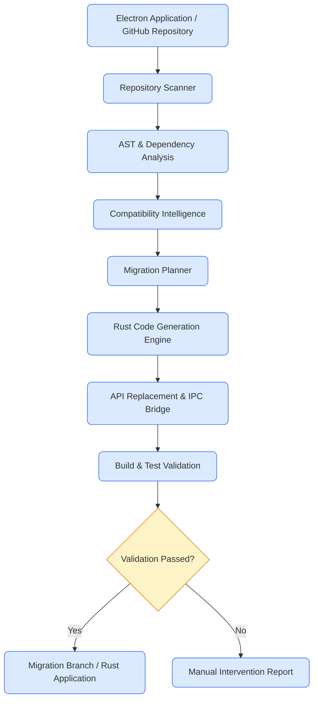
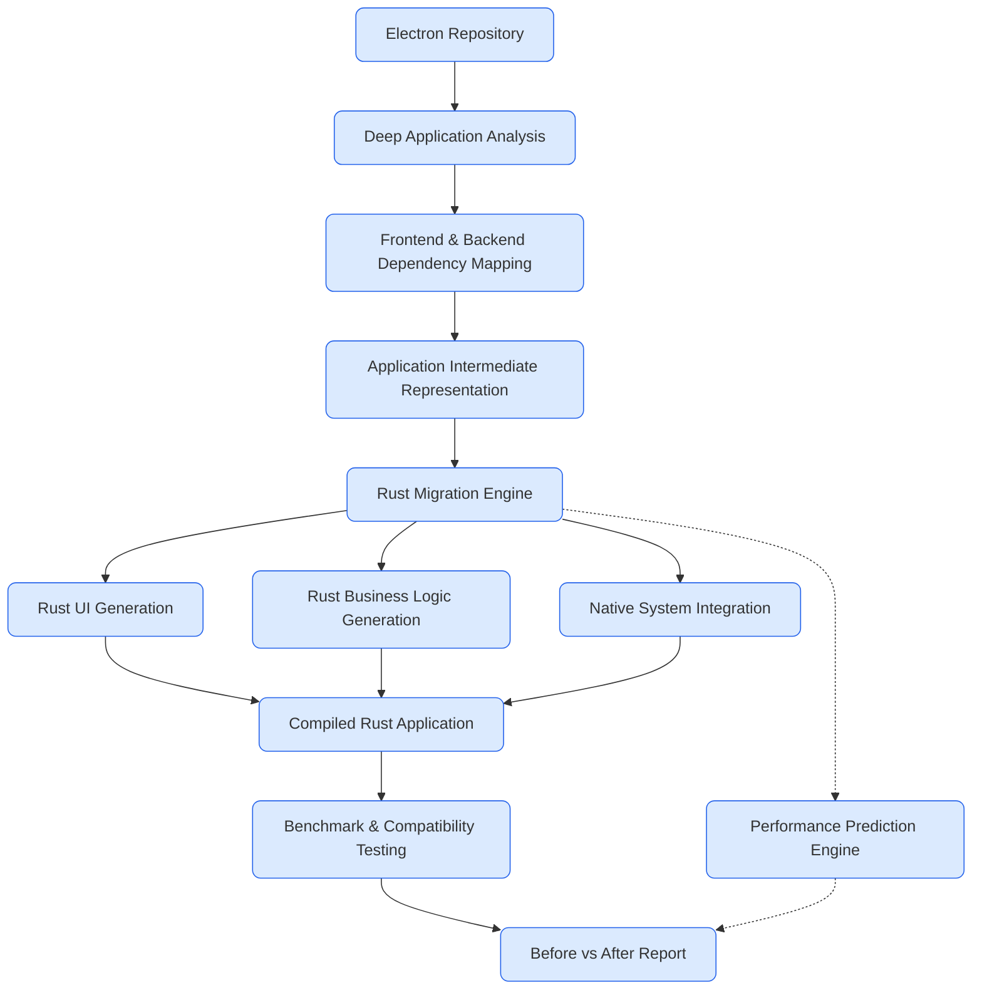

# Implementation: engineering architecture

The engineering design for the Migration Brain — the Intermediate Representation, the analyzer
pipeline, the compatibility database, codegen, the simulator, the decision registry, the
validation pipeline, the companion event protocol, and the ML learning loop. This document
describes the full design; the parts that exist in v0.1 are marked **[SHIPPED]**, the rest
**[PLANNED]** with the phase that delivers them.

Companion docs: [PRD.md](../PRD.md) (product vision and roadmap),
[ARCHITECTURE.md](ARCHITECTURE.md) (crate layout and module responsibilities),
[RND.md](RND.md) (research and prior art).

> **Naming note.** An early planning chat sketched this product as `rust-migrate` with a repo
> layout of `core/`, `analyzer/`, `compatibility/`, `migration-engine/`. That sketch is prior
> art. The umbrella repo is **Rust Made Easy**; the Phase 1 converter ships as
> **electron-to-rust** (`e2r`) under `converters/electron/`, with the workspace layout in
> [ARCHITECTURE.md](ARCHITECTURE.md).

## Pipeline at a glance

Two views of the same pipeline, both recreated from the original planning discussion as
native Mermaid. The first is the recommended architecture — the pipeline with its validation
gate. The second is the proposed product architecture — the end-to-end concept with the IR
and the Performance Prediction Engine; it is also the hero diagram in
[README.md](../README.md).



### Proposed product architecture




Mermaid source: [`assets/architecture.mmd`](assets/architecture.mmd). The SVG above is
rendered from that source (see [`assets/README.md`](assets/README.md) for the regen
command).

---

## 1. Intermediate Representation (IR) — [PLANNED, phase 1]

### 1.1 Why an IR, not source-to-source conversion

A naive source-to-source converter translates text: it sees `ipcMain.handle('read-file', …)`
and emits a Rust function. That works until it doesn't — aliased imports, dynamic requires,
wrapper libraries, and data flow all break text matching, and every new source framework or
target needs a new converter.

The IR is the fix: the engine builds a **typed, semantic model of the app** — its windows,
IPC channels, APIs, dependencies, and data flows — and everything downstream reasons about
the model, not the source text. New sources become new analyzers producing the same IR; new
targets become new codegen modules rendering from the same IR. The IR is the seam that makes
"anything to Rust" a real architecture.

### 1.2 IR schema (draft)

```rust
// e2r-core::ir — illustrative; the exact schema evolves with the analyzer.

pub struct AppIr {
    pub meta: AppMeta,              // name, version, entry points, framework
    pub windows: Vec<Window>,       // BrowserWindow declarations + options
    pub ipc: IpcGraph,              // channels, handlers, call sites, payloads
    pub apis: Vec<ApiUse>,          // Electron API uses, with file + line
    pub deps: Vec<Dependency>,      // Node deps, native modules flagged
    pub preload: Vec<PreloadScript>,// preload scripts + their bridge surface
    pub assets: Vec<Asset>,         // icons, static files, extra resources
    pub build: BuildConfig,         // packager config, signing, targets
}

pub struct AppMeta {
    pub name: String,
    pub version: String,
    pub frontend_framework: Framework, // React | Vue | Svelte | Angular | Quasar | Vanilla | Unknown
    pub main_entry: PathBuf,
    pub package_manager: PackageManager,
}

pub struct IpcGraph {
    pub channels: Vec<IpcChannel>,  // name, direction, handler location, payload shape (if inferable)
}

pub struct IpcChannel {
    pub name: String,
    pub direction: Direction,       // MainToRenderer | RendererToMain | Bidirectional
    pub handler: Option<Location>,  // where ipcMain.handle/on lives
    pub call_sites: Vec<Location>,  // where ipcRenderer.invoke/send/on lives
    pub payload: PayloadShape,      // Unknown | Inferred(String) — best effort in v1
}

pub struct ApiUse {
    pub api: String,                // e.g. "dialog.showOpenDialog"
    pub location: Location,
    pub mapping: MappingRef,        // resolved from the compatibility DB
}
```

Design rules:

- **The IR is serializable** (JSON) so it can be cached, diffed, sent to the companion, and
  inspected by agents. `e2r scan --ir` dumps it.
- **The IR is lossy by design about code, lossless about structure.** It does not contain
  function bodies — only the facts the migration needs. Handler bodies are ported by the
  agent, guided by the IR, not by the IR itself.
- **Every IR node carries provenance** (file + line) so any claim the tool makes can be
  traced back to the source that produced it.

### 1.3 v0.1 vs. IR

v0.1's `scan` produces a flat report (API list, IPC channel list, feasibility score) from
regex matching — effectively a proto-IR without the graph structure. The phase 1 analyzer
replaces the regex layer with a parser and produces the full IR; the scan report becomes a
rendering of the IR. The CLI surface (`e2r scan`) doesn't change; the depth underneath it does.

---

## 2. Analyzer pipeline — [SHIPPED: regex scan; PLANNED: parser-based, phase 1]

```
app directory
  │  1. manifest:   read package.json (+ lockfile) → deps, scripts, electron version
  │  2. entry:      find main entry, preload scripts, renderer roots
  │  3. parse:      [v0.1] regex patterns over JS/TS files
  │                 [phase 1] real parser (swc-style AST) → resolve imports/aliases
  │  4. inventory:  Electron APIs, IPC channels (both ends), native modules
  │  5. framework:  detect renderer framework from deps + file shapes
  │  6. risk:       flag Chromium-only APIs, DRM, deep OS integration, WebKit-sensitive UI
  ▼
IR + compatibility report + feasibility score
```

Analyzer requirements:

- **Read-only.** The analyzer never writes to the source app. All output goes to stdout, a
  report file, or the `--out` directory of a conversion.
- **Deterministic.** Same app, same IR. No timestamps, no randomness, no network.
- **Honest about limits.** The report states the analysis method (regex in v0.1, parser in
  phase 1) and its known blind spots — dynamic requires, aliased imports, wrapper libraries —
  rather than claiming completeness it doesn't have.
- **Fast enough to run on every save.** The scan is the tight loop of the whole product; the
  analyzer budget is seconds, not minutes, for a typical app.

---

## 3. Compatibility DB schema — [SHIPPED: JSON; PLANNED: versioned + extensible, phase 1]

The compatibility database is `converters/electron/mappings/electron-to-tauri.json` in v0.1 — a flat list of
entries, each one a deterministic replacement. The phase 1 design versions it and adds the
fields the simulator and the decision registry need.

```jsonc
// converters/electron/mappings/electron-to-tauri.json — entry schema (v0.1 fields + planned additions)
{
  "electron_api": "ipcMain.handle",
  "tauri_target": "#[tauri::command]",
  "plugin": null,               // tauri plugin name, if the mapping needs one
  "crate": null,                // Rust crate, if the mapping needs one (e.g. portable-pty)
  "status": "AUTO",             // AUTO | ASSISTED | MANUAL
  "command_template": "ipc_handle", // codegen template id (AUTO/ASSISTED only)
  "notes": "Channel name becomes the command name (snake_case).",
  // --- planned (phase 1+) ---
  "schema_version": 1,
  "confidence": "high",         // high | medium | low — how sure we are this mapping is right
  "effort_estimate": "trivial", // trivial | small | medium | large — for the simulator
  "verified_by": ["converters/electron/fixtures/minimal-electron-app"], // fixtures proving this mapping
  "replaces": ["node-pty"],     // for native-module recipes: what this replaces
  "decision": "Use invoke() + #[tauri::command]; do not emulate ipcMain.on with polling."
}
```

Rules:

- **The JSON is the source of truth.** [API-MAP.md](API-MAP.md) mirrors it; codegen reads it;
  the MCP `get_rust_replacement` op serves it. One source, many renderings.
- **Every AUTO entry must have a fixture** proving the generated code compiles. An AUTO entry
  without a fixture is a bug.
- **ASSISTED entries must name the decision** the human makes, so `MIGRATION-NOTES.md` can
  quote it verbatim.
- **MANUAL entries must name the replacement or the reason.** Silence is not an option.

---

## 4. Codegen templates — [SHIPPED: v0.1 templates]

Codegen renders the Tauri project from the scan result (v0.1) / the IR (phase 1+) plus the
mappings. In v0.1 the generators are `gen_*` functions inside `convert.rs` (one per output
file); splitting them into a `codegen/` module is a planned refactor, not yet done.

| Generator | Output | Contents |
| --- | --- | --- |
| `gen_cargo_toml` | `src-tauri/Cargo.toml` | Tauri 2 app + only the plugins the app's APIs need |
| `gen_tauri_conf` | `src-tauri/tauri.conf.json` | Windows (from `BrowserWindow` options), bundle config |
| `gen_lib_rs` / `gen_main_rs` | `src-tauri/src/{lib,main}.rs` | Plugin setup, window setup, entry point |
| `gen_commands_rs` | `src-tauri/src/commands.rs` | One `#[tauri::command]` per `ipcMain.handle` channel (TODO-marked stubs that compile) |
| `gen_menu_rs` | `src-tauri/src/menu.rs` | Menu builder (when a static template was found; original template kept as comments) |
| `gen_bridge_ts` | `src/lib/e2r-bridge.ts` | Typed `invoke()` wrapper replacing `ipcRenderer`; one function per channel |
| `gen_notes` | `MIGRATION-NOTES.md` | What converted, what needs a human, what can't — with file/line references |

Also generated: `src-tauri/build.rs` (required by `generate_context!()`), a placeholder
`src-tauri/icons/icon.png` (128×128; `generate_context!()` panics without an icon), a
placeholder `dist/index.html` (`frontendDist` must exist for the build), `package.json`,
`.gitignore`, and a generated `README.md` with the next steps. Capability files
(`capabilities/`) are **not** generated in v0.1 — least-privilege capabilities arrive with
the Tauri 2 permissions work in a later phase.

Template rules:

- **Templates are data-driven, not hardcoded translations.** A template renders what the
  mapping says; adding a mapping adds a template, not a code change in the core.
- **Generated code must compile.** The golden-fixture test runs `cargo check` on the
  generated project in CI. A template that generates broken code fails the build.
- **Generated code is readable scaffolding, not magic.** It carries comments naming the
  Electron API it came from, so the developer can read the migration.
- **The renderer is NOT copied in v0.1.** The generated project ships a placeholder
  `dist/index.html`; the developer copies their renderer source into `src/` (or points
  `build.frontendDist` at their existing build output) and deletes the placeholder, as
  `MIGRATION-NOTES.md` explains. Automatic renderer copying is planned — in UI-preserving
  mode the frontend files will be copied verbatim and only the IPC transport changes.

---

## 5. Simulator design — [PLANNED, phase 1]

The pre-migration simulator is the killer feature: it predicts the migration's shape and
payoff **before any code changes**.

### 5.1 Inputs

- The IR (API inventory, IPC graph, dependency list, framework, size metrics).
- The compatibility DB (status + effort estimate per API).
- Historical calibration data (phase 4 learning loop; initially, conservative defaults).

### 5.2 Outputs

- **Migratable %** — share of the API surface that is AUTO, ASSISTED, MANUAL.
- **UI preserved %** — share of the renderer that carries over unchanged (100% in
  UI-preserving mode by construction; the number matters for full-native mode).
- **Predicted gains with confidence ranges** — memory, CPU, startup time, bundle size, each
  as a range (e.g. "bundle 120 MB → 15–35 MB, medium confidence"), never a single number.
- **Warnings** — DRM, native modules, WebKit-sensitive UI on Linux, Chromium-only APIs.
- **Effort estimate** — staged, by phase of the migration ladder.

### 5.3 Honesty rules

- Predictions are **ranges with confidence levels**, computed from the IR and the
  compatibility DB — not from vibes, and never from the planning chat's illustrative samples.
- The simulator **shows its work**: every predicted number links to the IR facts and mapping
  entries it came from.
- Where the model has no basis (e.g. an app dominated by MANUAL APIs), the simulator says
  "low confidence" or declines to predict, rather than inventing a number.

> **Illustrative example of output shape (NOT a measurement).** The planning chat sketched
> simulator output shaped like: readiness 86/100; 82% of APIs migratable, 18% custom, 94% UI
> preserved; startup 2.1s → 1.7s; memory 380 MB → 265 MB; CPU 22% → 9%; binary 120 MB →
> 28 MB. These are invented examples. Real simulator output will be ranges with confidence
> levels, computed from real IR data, and measured against actuals after migration.

---

## 6. Decision registry format — [PLANNED, phase 1]

Every migration decision is recorded with its reason, so agents don't repeat mistakes across
sessions or across apps. The registry is a JSONL file written into the output project (and
queryable via the MCP `get_decision_log` op).

```jsonc
// .e2r/decisions.jsonl — one JSON object per line
{"id": "d-001", "scope": "api", "subject": "dialog.showOpenDialog",
 "decision": "Map to tauri-plugin-dialog `open()`",
 "reason": "Options map 1:1 except `properties` values; filters carry over.",
 "made_by": "mapping:dialog.showOpenDialog", "at": "2026-11-25T00:00:00Z"}
{"id": "d-002", "scope": "api", "subject": "session.cookies",
 "decision": "MANUAL — no conversion; flag for human design",
 "reason": "System webview cookie handling is thinner than Chromium session API.",
 "made_by": "mapping:session", "at": "2026-11-25T00:00:00Z"}
{"id": "d-003", "scope": "project", "subject": "preload.js",
 "decision": "Port verbatim (sandboxed preload: contextBridge + ipcRenderer only)",
 "reason": "Transport rebind is sufficient; no Node APIs in preload.",
 "made_by": "agent:claude-code", "at": "2026-11-25T00:05:00Z"}
```

Rules:

- **Append-only.** Decisions are never edited; a changed decision is a new entry superseding
  the old one (with a `supersedes` field).
- **Every entry has a reason.** A decision without a reason is not recorded.
- **Agents read the registry before deciding.** The MCP op exists so any agent can check what
  was already decided — including decisions made by a different agent in an earlier session.

---

## 7. Validation pipeline — [SHIPPED: build check; PLANNED: full pipeline, phases 2–4]

```
generated project
  │  1. build:      cargo check (+ cargo build for the golden fixture)
  │  2. coverage:   every API in the IR has a mapping entry; every IPC channel
  │                 has a handler on both sides
  │  3. parity:     [phase 2] record/replay — run original + migrated through the
  │                 same cases, diff behavior (rust-anything style)
  │  4. ui-regress: [phase 4] screenshot / DOM diff of original vs. migrated UI
  │  5. bench:      [phase 4] measure actual memory / CPU / startup / bundle,
  │                 compare against the simulator's prediction
  ▼
validation report (+ events on the bus)
```

Validation results are events, not just a report: the companion window shows them as they
land, and the learning loop consumes the bench step's actuals.

---

## 8. Event protocol for the companion — [PLANNED, phase 3]

The core publishes structured events; the companion subscribes. Transport is **local
IPC/WebSocket** (loopback only — the migration's data never leaves the machine).

### 8.1 Transport

- The core (CLI or MCP server) opens a loopback WebSocket server on an ephemeral port when a
  migration starts, and prints the port (or writes it to `.e2r/events.sock` info).
- The companion connects, subscribes, and renders. Multiple subscribers are allowed (overlay
  + workspace app at once).
- If no companion is running, events are still recorded to `.e2r/events.jsonl` — Migration
  Replay reads the log, so nothing is lost.

### 8.2 Event schema

```jsonc
// Every event: { type, at, migration_id, ...payload }
{"type": "migration.started", "at": "...", "migration_id": "m-1",
 "app": "my-electron-app", "mode": "ui-preserving"}
{"type": "file.analyzed", "at": "...", "migration_id": "m-1",
 "file": "src/main.js", "apis_found": 12}
{"type": "api.replaced", "at": "...", "migration_id": "m-1",
 "api": "ipcMain.handle", "channel": "read-file",
 "replacement": "#[tauri::command] fn read_file()"}
{"type": "rust.generated", "at": "...", "migration_id": "m-1",
 "file": "src-tauri/src/commands.rs", "commands": 14}
{"type": "simulation.done", "at": "...", "migration_id": "m-1",
 "migratable_pct": 82, "ui_preserved_pct": 100, "warnings": 3}
{"type": "validation.failed", "at": "...", "migration_id": "m-1",
 "check": "parity:read-file", "detail": "mismatch on empty-file case"}
{"type": "migration.done", "at": "...", "migration_id": "m-1",
 "duration_s": 184, "apis_auto": 24, "apis_assisted": 9, "apis_manual": 5}
```

Event rules:

- **Events are facts, not UI.** The companion decides how to render them; the core only
  reports what happened.
- **Events are ordered and replayable.** The JSONL log plus the decision registry is the
  complete audit trail — Migration Replay is a player for this log.
- **No secrets in events.** File paths and API names are fine; file contents, credentials,
  and user data are never emitted.

---

## 9. ML / learning loop — [PLANNED, phase 4]

The Performance Prediction Engine gets better by learning from every migration:

```
simulate (predict ranges)
    │  migration runs
    ▼
measure (actual memory / CPU / startup / bundle)
    │  compare
    ▼
discrepancy record: { app profile, predicted range, actual, delta }
    │  aggregate across migrations (locally; opt-in sharing later)
    ▼
calibration update: adjust the simulator's model for similar app profiles
```

Design constraints:

- **Learning is local first.** Discrepancy records live on the developer's machine. Any
  sharing (Phase 5 hosted intelligence) is opt-in, aggregated, and anonymous — the core never
  phones home.
- **The model is explainable.** The simulator's predictions must stay traceable to IR facts
  and mapping entries. A black-box model that can't show its work doesn't ship.
- **Calibration is versioned.** A model update ships with the mappings DB version it was
  calibrated against, so predictions are reproducible.

What the loop learns, concretely: which API mixes predict which bundle sizes, how IPC-heavy
apps actually behave on memory, where the simulator systematically over- or under-predicts.
The goal is narrower confidence ranges over time, not a bigger model.

---

## 10. Phased build plan

Mapping the design above to the five phases in [PRD.md](../PRD.md):

| Phase | Engineering deliverables |
| --- | --- |
| **1 — Core Intelligence & Simulation** | v0.1 CLI (shipped: scan, convert, mappings, fixture, CI) → parser-based analyzer → IR (schema + JSON) → simulator (ranges + confidence) → decision registry → compatibility DB v1 (versioned schema). |
| **2 — Agent Integration** | MCP server (`e2r-mcp`) with the six standard ops → agent skills (OpenCode, Claude Code, Codex, Antigravity) → IDE extensions → record/replay parity checks → Stage 1 sidecar-shim mode. |
| **3 — Companion Experience** | Event bus (`e2r-core::events`, local IPC/WebSocket) → companion app (`e2r-companion`, Tauri + Rust; overlay + workspace forms) → three modes (Simulation / Live / Verification) → Migration Replay from the event log → Developer Dashboard views. |
| **4 — ML & Validation** | UI regression detection → bench step + discrepancy records → calibration loop → native-module recipes → full-native UI target option (egui / Iced / Dioxus / Slint, accessibility assessed first). |
| **5 — Marketplace & Hosted Intelligence** | Community mapping/recipe marketplace (submission + review pipeline) → optional hosted intelligence (opt-in, aggregated calibration data; team dashboards) → the core stays local-first and open source. |
| **5+ — Anything-to-Rust** | New analyzers (Android apps, other frameworks) producing the same IR → new codegen targets → the Brain, unchanged, reasoning about new sources. |

The invariant across all phases: **the IR is the seam**. Everything upstream knows about
Electron; everything downstream doesn't. Build the seam right in Phase 1, and every later
phase is an addition, not a rewrite.
